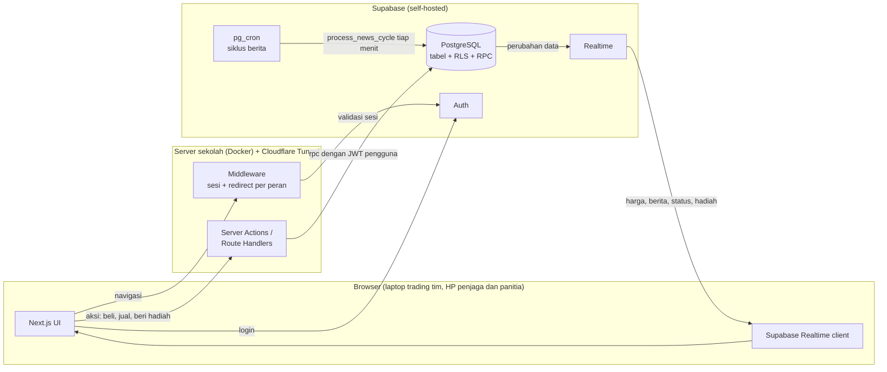
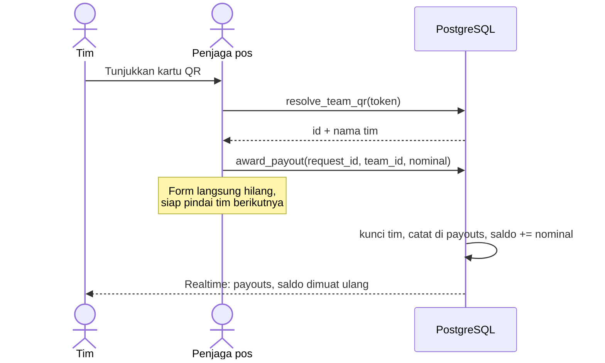
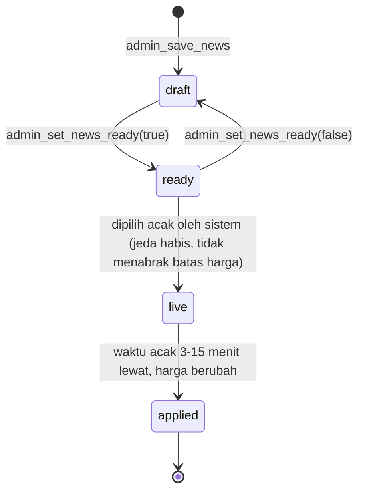
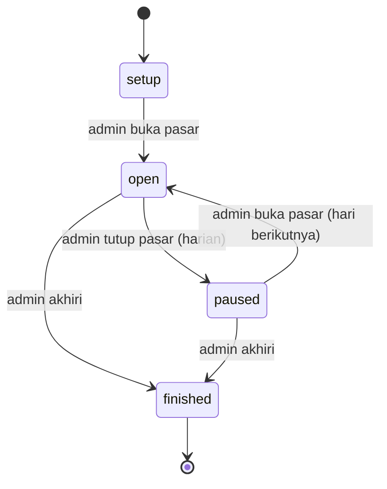

# 02 — Arsitektur

## 1. Stack

| Lapisan | Pilihan | Alasan |
|---------|---------|--------|
| Framework | Next.js (App Router) + TypeScript | Server Actions dan Route Handlers dalam satu proyek, stack yang sudah dikuasai |
| Styling | Tailwind CSS | Cepat, konsisten dengan proyek lain |
| Validasi | Zod | Validasi input di server action sebelum memanggil database |
| Database | PostgreSQL (Supabase self-hosted, Docker) | Transaksi ACID, row lock, constraint, RLS |
| Auth | Supabase Auth (email + password) | Sesi dan token siap pakai |
| Realtime | Supabase Realtime (Postgres Changes) | Cukup untuk harga, berita, status game, saldo hadiah |
| Penjadwal | `pg_cron` (ekstensi di image Postgres Supabase; **harus diverifikasi di Docker**, lihat 11) | Siklus berita (efek harga pada waktu acak 3–15 menit, pemilihan dan peluncuran berita) tiap 10 detik di dalam database, tidak bergantung pada server web |
| Pemindai QR | Pustaka QR di browser (kamera ponsel penjaga dan **kamera laptop trading**) | Tanpa aplikasi tambahan; butuh HTTPS (dari Cloudflare Tunnel) |
| Hosting | Docker di server sekolah (Next.js + Supabase self-hosted), dibuka lewat **Cloudflare Tunnel** + domain panitia | Server sudah tersedia; HTTPS tanpa mengurus sertifikat. Risiko: internet sekolah menjadi titik gagal (lihat 11) |

### Kenapa tanpa Redis

- Beban kecil: kurang dari 50 pengguna bersamaan. Cache tidak dibutuhkan.
- Redis tidak memberi jaminan transaksi lintas beberapa data (saldo + stok + riwayat) seperti PostgreSQL.
- Satu layanan lagi berarti satu titik gagal lagi saat hari-H.
- Kalau suatu hari butuh cache atau rate limiter, Redis bisa ditambahkan tanpa mengubah model data.

## 2. Diagram komponen



Poin penting:
- Server Action memanggil database **dengan JWT milik pengguna**, bukan service role. Dengan begitu `auth.uid()` di dalam fungsi database adalah pengguna sebenarnya dan RLS tetap berlaku.
- Service role hanya dipakai di skrip seed lokal untuk membuat akun massal. Kunci itu **tidak pernah** ada di kode yang berjalan di browser atau di env publik.

## 3. Alur data utama

### 3.1 Pasang order

```mermaid
sequenceDiagram
  actor T as Tim
  participant UI as UI (Next.js)
  participant SA as Server Action
  participant DB as PostgreSQL

  T->>UI: Isi form order (Beli/Jual, Limit/Market, harga, lot), tekan Place Order
  UI->>UI: Buat request_id (UUID), nonaktifkan tombol
  UI->>SA: placeOrder(request_id, asset_id, side, kind, price?, qty)
  SA->>SA: Validasi Zod, cek sesi
  SA->>DB: rpc place_order(...)
  activate DB
  DB->>DB: ob_lock (satu antrean untuk semua order), kunci baris tim
  DB->>DB: Cek idempotensi (request_id) dan status game = open
  DB->>DB: Validasi fraksi harga dan batas ARA/ARB
  DB->>DB: Kunci saldo (beli) atau lot (jual)
  DB->>DB: Cocokkan: harga terbaik dulu, lalu waktu; bandar dan order tim lain
  DB->>DB: Tiap pencocokan: pindah uang + lot, biaya 0,25 %, catat trades, perbarui harga terakhir
  deactivate DB
  DB-->>SA: baris order (status, sisa) / error code
  SA-->>UI: hasil (sukses atau pesan error ramah)
  Note over UI,DB: Layar tim memuat ulang order book dan saldo secara berkala; order sisa tetap antre
```

Seluruh langkah di dalam `DB` adalah **satu transaksi**. Kalau satu langkah gagal, semuanya dibatalkan. Kuotasi bandar dipasang ulang oleh penjadwal (`process_market_cycle`, tiap 10 detik, isi ulang tiap 5 menit) dan oleh `process_news_cycle` setelah harga acuan berubah.

### 3.2 Hadiah pos: kartu QR, langsung masuk



Saldo berubah seketika, sekali per `request_id`. **Tidak ada persetujuan admin** (diputuskan 13 Nov; sistem ACC dihapus tanpa pengaman pengganti). Rincian di [04-rpc-contracts](04-rpc-contracts.md#32-alur-hadiah-pos-kartu-qr--hadiah-langsung-masuk).

### 3.3 Siklus berita: dipilih sistem, waktu efek acak 3–15 menit

```mermaid
sequenceDiagram
  actor A as Admin
  participant DB as PostgreSQL
  participant C as pg_cron (tiap 10 detik)
  participant RT as Realtime
  actor T as Layar publik + laptop trading

  A->>DB: admin_save_news(judul, isi, 4-7 efek per aset)
  DB->>DB: validasi aturan efek (ditolak bila melanggar)
  A->>DB: admin_set_news_ready(id, true)
  DB->>DB: validasi lagi; status draft -> ready (masuk kumpulan)
  C->>DB: process_news_cycle()
  DB->>DB: kunci game_settings; status open?
  DB->>DB: tak ada berita live (dan jeda antarberita, default 0, lewat)
  DB->>DB: pilih ACAK satu berita ready yang tidak membuat harga menabrak batas min/maks -> live (effect_at = sekarang + jeda acak 3-15 mnt, diundi sistem)
  DB-->>RT: berita tayang
  RT-->>T: teks berita muncul, harga belum berubah
  C->>DB: process_news_cycle() (setelah effect_at)
  DB->>DB: terapkan efek ke 4-7 aset, bulatkan, jepit min/maks; tulis price_history
  DB->>DB: live -> applied; berita berikutnya boleh dipilih
  DB-->>RT: perubahan assets
  RT-->>T: harga baru muncul serentak
```

Admin tidak memilih berita berikutnya; ia hanya menyiapkan kumpulan. Tidak ada pergerakan harga acak (yang acak hanya pemilihan berita). Menutup pasar (jeda) menghentikan seluruh siklus dan menggeser tenggat saat dilanjutkan. Rincian di [04-rpc-contracts](04-rpc-contracts.md#34-siklus-berita-efek-tertunda-jeda-dan-antrean).

### 3.4 Status sebuah berita



Paling banyak satu berita `live` pada satu waktu (dijaga indeks unik di database); berita `ready` boleh banyak. Tidak ada status `queued` dan tidak ada `cancelled`: panitia tidak punya jalan untuk mengantre, menimpa, atau membatalkan berita. Sejak game dibuka, kumpulan, harga, dan parameter berita **dikunci oleh pemicu database** (`guard_game_lock()`); hanya fungsi sistem yang boleh menulisnya.

### 3.5 Masuk di laptop trading (QR sebagai kunci)

```mermaid
sequenceDiagram
  actor T as Tim (membawa kartu QR)
  participant K as Laptop trading (/kiosk)
  participant AU as Supabase Auth
  participant DB as PostgreSQL

  K->>AU: saat halaman dibuka: signOut (global) untuk sesi sebelumnya
  T->>K: arahkan kartu ke kamera
  K->>K: baca QR: nama akun + rahasia
  K->>AU: signInWithPassword(email akun tim, rahasia)
  AU-->>K: sesi tim
  K->>DB: log_kiosk_event('login', nama laptop)
  Note over K: pasar, portofolio, beli/jual; timer 5 menit tanpa gerakan
  T->>K: tekan Selesai (atau 5 menit tanpa gerakan)
  K->>DB: log_kiosk_event('logout' / 'idle_logout')
  K->>AU: signOut (global, token dicabut)
```

- QR memuat dua bagian: nama akun tim dan rahasia (`qr_token`). Rahasia yang sama adalah **kata sandi akun tim** di Supabase Auth, jadi masuk memakai alur login biasa tanpa `service role` di jalur permintaan. Penjaga hanya memakai bagian rahasia untuk `resolve_team_qr`.
- Mengganti QR (kartu hilang atau dicurigai bocor) harus mengubah `qr_token` **dan** kata sandi akun. Itu dikerjakan `scripts/rotate-team-qr.ts` di laptop panitia (memakai `service role`); `admin_rotate_team_qr` saja tidak cukup untuk login.
- Keluar otomatis ada di dua lapis: timer di browser (5 menit tanpa sentuhan, papan ketik, atau pemindaian) dan masa berlaku token yang pendek sebagai cadangan. Halaman `/kiosk` selalu memulai dengan `signOut`, jadi sesi yang tertinggal tidak terbawa ke tim berikutnya.
- Kode cadangan 6 karakter (`short_code`) **tidak dipakai UI v1** (penjaga hanya memindai). Kolom dan RPC-nya dipertahankan untuk keperluan teknis lewat konsol; **tidak** bisa dipakai masuk.

## 4. Mesin status game



| Status | Beli/jual | Hadiah pos | Siklus berita (terbit, efek, jeda) | Siapkan berita (draf / siap) |
|--------|-----------|------------|------------------------------------|--------------------|
| `setup` | Tidak | Tidak | Tidak jalan | Admin boleh (terbit saat pasar dibuka) |
| `open` | Ya | Ya | **Jalan** (sistem memilih berita) | Ya |
| `paused` | Tidak | Ya | **Berhenti** (tenggat bergeser saat lanjut). Dipakai sebagai *Tutup pasar* harian | Admin boleh |
| `finished` | Tidak | Tidak | Tidak jalan | Tidak |

Leaderboard (layar publik) mengikuti `leaderboard_visible` dan pembekuan, apa pun statusnya; saat `finished` otomatis dibekukan. Menutup game ditekan manual oleh admin setelah perubahan harga terakhir. Saat masih ada berita `live`/`queued`, penutupan ditolak kecuali `force` (berita dibatalkan).

Status disimpan di satu baris `game_settings`. Setiap fungsi yang mengubah uang membaca status ini di dalam transaksi yang sama, **setelah** mengunci baris tim. Menutup game mengunci semua baris tim lebih dulu; itulah yang menjamin snapshot leaderboard tidak didahului transaksi yang "nyelip" (diuji, lihat [10-verification-report](10-verification-report.md)).

## 5. Realtime

Yang dipantau lewat Postgres Changes (RLS tetap berlaku untuk tiap pelanggan):

| Tabel | Siapa berlangganan | Untuk apa |
|-------|--------------------|-----------|
| `assets` | Semua peran | Harga dan stok terbarui |
| `news_feed` (judul, isi, waktu tayang; **tanpa** waktu efek) | Semua peran | Berita baru. Tabel `news` (berisi `effect_at`) hanya terbaca admin |
| `game_settings` | Semua peran | Pasar dibuka, dijeda, ditutup |
| `posts` | Semua peran | Status pos tersedia / tidak berubah di halaman Daftar pos tim |
| `payouts` | admin (semua), penjaga (pos sendiri), tim (miliknya) | Pemicu muat ulang saldo di layar tim (hadiah baru) dan penyegaran daftar di layar penjaga |

Leaderboard dan saldo **tidak** dipantau per baris (`teams` tidak masuk publikasi Realtime). Layar publik memanggil `get_leaderboard()` setiap ±5 detik. Akun tim memanggil `get_my_summary()` setiap ±10 detik dan segera setelah ada event `payouts` miliknya. Ini lebih sederhana dan lebih aman daripada membuka `teams` untuk Realtime.


**Realtime hanyalah pemberitahuan, bukan sumber kebenaran.** Jika koneksi putus, UI harus mengambil ulang data dari API saat tersambung lagi, dan tombol beli/jual tetap divalidasi server.

### 5.1 Pengambilan data di browser: TanStack Query

Papan yang hidup (Pasar, Portofolio, Riwayat, Beranda, layar publik, admin, penjaga) memakai **TanStack Query** (`lib/query/`), bukan lagi `useState` + polling buatan sendiri:

- **Data awal dari server** (RSC) masuk sebagai `initialData` (`seed`/`seedMaybe`), jadi tidak ada kedipan loading dan tidak ada panggilan ulang saat halaman pertama dipasang. Selanjutnya polling dengan `pollOptions(ms)`: berhenti saat tab tersembunyi, mengambil ulang saat tab aktif lagi, jendela fokus, atau koneksi tersambung (data awal dianggap baru setengah interval).
- **Kunci bersama** (`lib/query/keys.ts`): satu sumber data = satu kunci, dipakai lintas komponen dan halaman (`summary`, `holdings`, `game`, `news`...). Panggilan RPC yang sama digabung, dan pindah halaman menampilkan cache lalu menyegarkannya.
- **`fetchX` tetap mengembalikan `null` saat gagal**; `must()` mengubahnya jadi galat supaya Query mempertahankan data lama dan menandai `isError` (pengganti penanda "mencoba lagi…"). Tidak ada retry otomatis (`retry: false`): kegagalan sementara ditangani ketukan polling berikutnya, dan galat aturan game (mis. `insufficient_cash`) tidak diulang.
- **Realtime = pemberitahuan**: `useRealtime` (satu kanal per papan) hanya memanggil `invalidateQueries`; bila kanal putus lalu tersambung ulang, semua query aktif diambil ulang.
- **Sesudah transaksi** (`invalidateAfterTrade`): pasar, saldo, berita, Portofolio, dan Riwayat ditandai kedaluwarsa sekaligus.
- **Penyedia cache per area** (`QueryProvider` di layout tim, admin, guard, dan `DisplayGate`), bukan di layout akar: berpindah akun melewati `/login` di luar penyedia, sehingga cache akun sebelumnya terbuang.


## 6. Struktur repositori usulan

```
classmeet/
├─ docs/                      # dokumen ini
├─ supabase/
│  ├─ migrations/             # SQL berurutan (0001_init.sql, ...)
│  ├─ seed.sql                # aset, pos, pengaturan awal
│  └─ tests/                  # uji SQL (konkurensi, RLS); lihat docs/tests
├─ scripts/
│  ├─ create-accounts.ts      # buat akun massal + short_code tim; kata sandi akun tim = qr_token (service role, lokal)
│  ├─ rotate-team-qr.ts       # ganti QR tim: ubah qr_token DAN kata sandi akun sekaligus (service role, lokal)
│  ├─ import-news.ts          # periksa + simulasi + impor berita dari news.json (login admin)
│  ├─ news-lib.ts             # rumus harga dan aturan berita (murni, dipakai import-news)
│  ├─ print-qr.ts             # cetak kartu tim berisi QR (qr_token) dan nama tim
│  └─ export-results.ts       # ekspor hasil ke CSV
├─ app/                       # Next.js App Router (tanpa folder src/)
│  ├─ (auth)/login/
│  ├─ kiosk/                  # layar masuk laptop trading: pindai QR tim, keluar otomatis 5 menit
│  ├─ team/                   # beranda (hero 3 angka + berita), market (tanpa tombol jual), portfolio (jual di sini), history, daftar pos
│  ├─ guard/                  # pindai QR, toggle pos, form nominal, antrean lokal (tanpa daftar hadiah/riwayat)
│  ├─ display/                # leaderboard layar publik (akun display)
│  ├─ admin/                  # state, assets, news (tampilan saja: berita saat ini + berikutnya), teams, posts, audit, export
│  └─ api/health/             # cek kesehatan
├─ lib/
│  ├─ supabase/               # client browser, client server, middleware
│  ├─ schemas/                # skema Zod per aksi
│  └─ money.ts                # format rupiah, helper bigint
├─ actions/                   # server actions: trade.ts, payout.ts, review.ts, news.ts, admin.ts
├─ components/                # UI bersama
├─ middleware.ts              # sesi + redirect per peran
├─ .env.example
└─ package.json
```

## 7. Variabel lingkungan

| Variabel | Dipakai di | Rahasia? |
|----------|-----------|----------|
| `NEXT_PUBLIC_SUPABASE_URL` | Browser + server | Tidak |
| `NEXT_PUBLIC_SUPABASE_ANON_KEY` | Browser + server | Tidak (dibatasi RLS) |
| `SUPABASE_SERVICE_ROLE_KEY` | **Hanya skrip di laptop panitia** | **Ya, jangan pernah di-commit atau dimasukkan ke container aplikasi** |
| `DATABASE_URL` | Skrip backup/uji lokal | Ya |

Aturan: file `.env*` masuk `.gitignore`; yang di-commit hanya `.env.example` tanpa nilai.

## 8. Penanganan error di lapisan aplikasi

- Fungsi database melempar error dengan kode tetap (lihat [04-rpc-contracts](04-rpc-contracts.md#7-error-code)).
- Server Action memetakan kode itu ke pesan Bahasa Indonesia yang ramah, misalnya `out_of_stock` → "Stok habis, ada tim lain yang lebih cepat."
- Error tak terduga dicatat di log server dan pengguna hanya melihat "Terjadi kesalahan, coba lagi." Jangan pernah menampilkan pesan SQL mentah.
- Aksi yang gagal karena jaringan boleh diulang dengan `request_id` yang **sama**. Aksi baru memakai `request_id` baru.

## 9. Keputusan arsitektur (ringkas)

| Keputusan | Alternatif | Alasan memilih |
|-----------|------------|----------------|
| PostgreSQL sebagai satu-satunya sumber data | Redis + DB | Cukup, lebih sedikit titik gagal |
| Logika uang di fungsi database | Logika di Next.js | Atomik, tidak ada race condition antar permintaan |
| Harga hanya berubah lewat berita yang dipilih sistem secara acak berbatas, efek tertunda pada waktu acak 3–15 menit; panitia tidak bisa mengubah harga atau berita sejak game dibuka | Tick acak otomatis; harga diubah manual; antrean berita oleh admin | Permintaan panitia 17 Nov: berita memuat petunjuk yang bisa dibaca tim, tetapi urutan dan waktunya milik sistem supaya tidak bisa dicurigai. Biaya: kumpulan harus lengkap (±220) sebelum game dibuka dan kesalahan tidak bisa dikoreksi di tengah jalan |
| Hadiah langsung masuk saldo, tanpa ACC | Pengajuan + ACC admin (sempat dipakai) | Keputusan panitia 13 Nov: menghilangkan antrean ACC yang menahan tim bersaldo Rp 0. Biaya: tidak ada pengaman terhadap salah ketik atau penjaga curang; pemulihan hanya lewat `admin_adjust_cash` |
| QR mengidentifikasi tim **dan** menjadi kunci masuk di laptop trading | QR + PIN; QR login terpisah | Diputuskan 13 Nov: tim tanpa ponsel, kartu fisik cukup. Risiko: siapa pun yang memegang kartu bisa berdagang atas nama tim; tertutup dengan log login dan penggantian QR seketika (lihat 06) |
| Siklus berita dijadwalkan `pg_cron` di database | Cron di server web | Berjalan walau server web bermasalah; satu tempat kebenaran |
| Leaderboard hanya untuk `admin` dan `display` | Terlihat oleh semua tim | Permintaan panitia; ditegakkan di database, bukan sekadar disembunyikan di UI |
| Leaderboard dihitung saat diminta | Tabel peringkat materialized | Data kecil, selalu akurat |
| Akun dibuat panitia | Pendaftaran mandiri | Mencegah akun palsu dan menyederhanakan peran |
