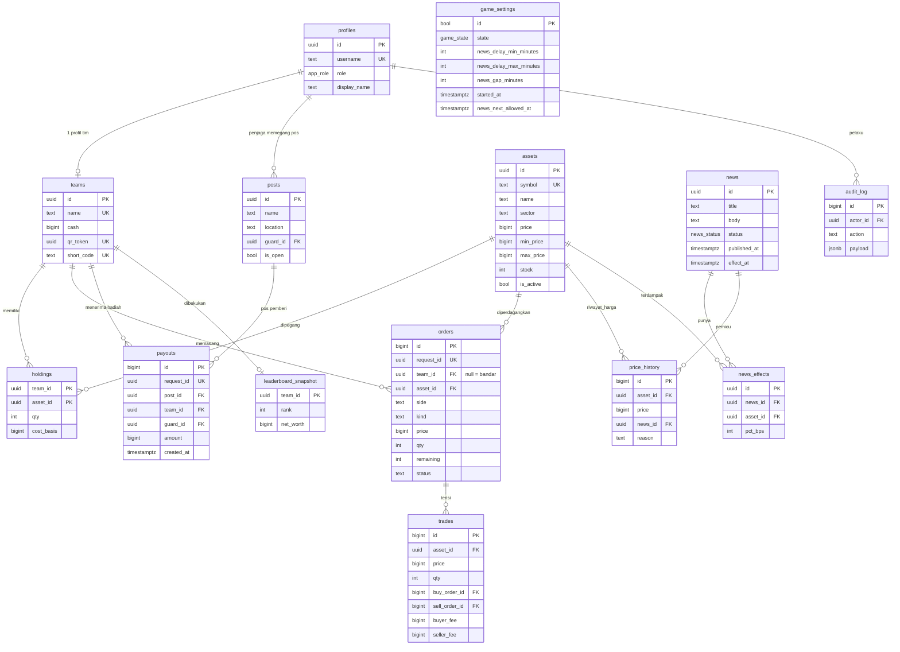

# 03 — Database

PostgreSQL di Supabase. SQL di bawah adalah **rancangan acuan** untuk migrasi `0001_init.sql`. Blok `sql` pada dokumen ini dan [04-rpc-contracts](04-rpc-contracts.md) dijalankan berurutan pada PostgreSQL 16 sungguhan untuk verifikasi (lihat [10-verification-report](10-verification-report.md)). Blok bertanda `-- [lewati-uji]` hanya berjalan di Supabase (mis. `pg_cron`).

## 1. ERD



## 2. Tipe dan helper

```sql
create type app_role      as enum ('admin', 'guard', 'team', 'display');
create type game_state    as enum ('setup', 'open', 'paused', 'finished');
-- draft: bisa disunting | ready: masuk kumpulan, dipilih acak oleh sistem | live: sudah tampil,
-- efek harga menunggu | applied: harga sudah berubah | cancelled: tidak dipakai lagi (tidak ada jalur yang membatalkan)
-- Tidak ada status 'queued': panitia tidak bisa memilih berita (diputuskan 17 Nov).
create type news_status   as enum ('draft', 'ready', 'live', 'applied', 'cancelled');

-- Bentuk hasil fungsi baca. Memakai tipe komposit agar nama kolom hasil
-- tidak bentrok dengan nama kolom tabel di dalam fungsi plpgsql.
create type leaderboard_row as (
  rank int, team_id uuid, team_name text,
  cash bigint, holdings_value bigint, net_worth bigint
);
-- cash = saldo yang bebas dipakai; locked_cash = saldo yang tertahan di order beli antre
create type my_summary as (cash bigint, holdings_value bigint, net_worth bigint, locked_cash bigint);
create type team_ref   as (team_id uuid, team_name text, cash bigint);  -- cash: saldo tim, ditampilkan ke penjaga saat form hadiah
create type post_payout_row as (
  id bigint, team_name text, amount bigint, created_at timestamptz
);
```

| Peran | Dipakai oleh | Hak |
|-------|--------------|-----|
| `admin` | Panitia pusat | Semua fungsi admin, melihat semua data |
| `guard` | Penjaga pos | Pindai QR tim, mengajukan hadiah untuk **posnya sendiri** |
| `team` | Satu akun per tim | Beli/jual, melihat data milik sendiri. **Tidak** bisa melihat leaderboard |
| `display` | Layar ruang publik | Hanya membaca leaderboard dan data pasar publik |

Helper `app_role()` didefinisikan di [bagian 3.1](#31-profiles), **setelah** tabel `profiles` ada. Fungsi SQL divalidasi saat dibuat, jadi urutan ini wajib.

## 3. Tabel

### 3.1 `profiles`

```sql
create table profiles (
  id           uuid primary key references auth.users(id) on delete cascade,
  username     text not null unique check (username ~ '^[a-z0-9_]{3,32}$'),
  role         app_role not null,
  display_name text not null,
  created_at   timestamptz not null default now()
);

-- Helper peran. Jangan beri nama "current_role" (kata kunci SQL).
-- security definer agar bisa membaca profiles tanpa memicu RLS rekursif
-- saat dipakai di kebijakan tabel lain.
create or replace function public.app_role()
returns app_role
language sql stable security definer
set search_path = public
as $$ select role from profiles where id = auth.uid() $$;
```

Username dipetakan ke email palsu `username@classmeet.local` di Supabase Auth agar peserta tidak perlu email.

### 3.2 `teams`

```sql
create table teams (
  id         uuid primary key references profiles(id) on delete cascade,
  name       text not null unique,
  cash       bigint not null default 0 check (cash >= 0),          -- saldo bebas
  locked_cash bigint not null default 0 check (locked_cash >= 0),  -- tertahan di order beli yang antre
  qr_token   uuid not null unique default gen_random_uuid(),
  short_code text not null unique check (short_code ~ '^[A-Z0-9]{6}$'),
  created_at timestamptz not null default now()
);
```

- **Modal awal Rp 0.** Tim baru bisa membeli aset setelah hadiah pos masuk ke saldo.
- `cash >= 0` adalah **sabuk pengaman terakhir**: kalau ada bug di fungsi, database menolak saldo negatif.
- `qr_token` adalah isi QR tim. UUID acak, tidak bisa ditebak. QR **hanya mengidentifikasi tim**; ia tidak memberi hak apa pun. Uang baru masuk setelah admin menyetujui.
- `short_code` adalah kode cadangan 6 karakter untuk diketik penjaga bila kamera/QR gagal. Dibuat oleh skrip `create-accounts.ts` (huruf besar dan angka, hindari `0/O/1/I` agar mudah dibaca).
- Jika QR bocor atau tercetak salah, admin memanggil `admin_rotate_team_qr` untuk menggantinya.

### 3.3 `posts`

```sql
create table posts (
  id          uuid primary key default gen_random_uuid(),
  name        text not null,
  location    text not null,
  guard_id    uuid not null unique references profiles(id),
  is_open     boolean not null default false,
  created_at  timestamptz not null default now()
);
```

- `guard_id` unik: satu penjaga memegang satu pos.
- **Tidak ada batas kunjungan per tim per pos.** Tim boleh mengunjungi pos yang sama berkali-kali.
- **Tidak ada batas nominal hadiah per pos** (diputuskan: tanpa pengaman). Nominal yang diketik penjaga langsung masuk saldo; kesalahan hanya bisa dikoreksi admin sesudahnya lewat `admin_adjust_cash`.

### 3.4 `assets`

```sql
create table assets (
  id             uuid primary key default gen_random_uuid(),
  symbol         text not null unique check (symbol ~ '^[A-Z0-9]{2,8}$'),
  name           text not null,
  sector         text not null,
  price          bigint not null check (price > 0),
  min_price      bigint not null check (min_price > 0),
  max_price      bigint not null,
  stock          int not null check (stock >= 0),     -- persediaan BANDAR (panitia); stok awal seluruhnya dipegang bandar
  last_price     bigint check (last_price > 0),       -- harga transaksi terakhir; null sebelum ada transaksi/berita. Inilah harga yang tampil dan dihitung
  rank_price     bigint check (rank_price > 0),       -- harga PERINGKAT: VWAP jendela waktu (game_settings.rank_window_minutes), dilapis harga peringkat sebelumnya bila volume tipis. Dipakai net worth dan leaderboard; null sebelum ada transaksi
  last_trade_at  timestamptz,
  base_price     bigint check (base_price > 0),       -- harga acuan saat pasar pertama dibuka, penyebut indeks IKC
  init_stock     int check (init_stock >= 0),         -- stok awal bandar, dasar lot per level kuotasi
  is_active      boolean not null default true,
  created_at     timestamptz not null default now(),
  check (max_price >= min_price),
  check (price between min_price and max_price)
);
create index on assets (sector);
```

`price` kini adalah **harga acuan**: hanya berubah oleh efek berita dan menjadi pusat kuotasi bandar serta dasar batas ARA/ARB. `last_price` adalah harga transaksi terakhir (hanya tampil di UI dan indeks). **`rank_price` adalah harga peringkat** (diputuskan 17 Nov, mitigasi kolusi): VWAP semua transaksi aset itu dalam `rank_window_minutes` terakhir (10), ditambah harga peringkat sebelumnya (atau harga acuan bila belum ada) sebagai pengisi sebanyak `rank_min_lots − volume jendela` lot bila volume jendela kurang dari `rank_min_lots` (5). Jadi satu transaksi kecil di pasar sepi hanya menggeser sebagian; harga baru sepenuhnya mengikuti transaksi bila volume jendela sudah mencapai `rank_min_lots`. Saat berita berlaku `last_price` dan `rank_price` disetel ulang ke acuan baru. `stock` adalah persediaan bandar. Tidak ada batas kepemilikan per tim (dihapus 16 Nov); pembatasnya stok bandar, order tim lain, dan saldo. Stok awal ditentukan per aset berdasarkan harga (murah: banyak, mahal: sedikit).

### 3.5 `holdings`

```sql
create table holdings (
  team_id    uuid not null references teams(id) on delete cascade,
  asset_id   uuid not null references assets(id),
  qty        int not null check (qty >= 0),            -- total milik tim, TERMASUK yang terkunci di order jual
  locked_qty int not null default 0 check (locked_qty >= 0 and locked_qty <= qty),
  cost_basis bigint not null check (cost_basis >= 0),  -- total biaya kepemilikan saat ini
  primary key (team_id, asset_id)
);
```

### 3.6 `orders` dan `trades`

```sql
create table orders (
  id           bigint generated always as identity primary key,   -- urutan id = prioritas waktu
  request_id   uuid unique,                                       -- idempotensi; null untuk order bandar
  team_id      uuid references teams(id),                         -- null = bandar
  asset_id     uuid not null references assets(id),
  side         text not null check (side in ('buy', 'sell')),
  kind         text not null check (kind in ('limit', 'market')),
  price        bigint check (price > 0),
  qty          int not null check (qty >= 1),
  remaining    int not null check (remaining >= 0 and remaining <= qty),
  lock_per_lot bigint not null default 0 check (lock_per_lot >= 0),  -- beli limit: harga + biaya per lot yang ditahan
  status       text not null default 'open' check (status in ('open', 'partial', 'filled', 'cancelled')),
  is_house     boolean not null default false,
  created_at   timestamptz not null default now(),
  closed_at    timestamptz,
  check ((is_house and team_id is null) or (not is_house and team_id is not null)),
  check (kind <> 'limit' or price is not null),
  check (status not in ('open', 'partial') or remaining > 0),
  check (status <> 'filled' or remaining = 0)
);
create index orders_book on orders (asset_id, side, price, id) where status in ('open', 'partial');
create index orders_team on orders (team_id, id desc);

create table trades (
  id            bigint generated always as identity primary key,
  asset_id      uuid not null references assets(id),
  price         bigint not null check (price > 0),     -- harga order yang sudah antre (maker)
  qty           int not null check (qty > 0),
  buy_order_id  bigint not null references orders(id),
  sell_order_id bigint not null references orders(id),
  buyer_id      uuid references teams(id),             -- null = bandar
  seller_id     uuid references teams(id),
  buyer_fee     bigint not null default 0 check (buyer_fee >= 0),
  seller_fee    bigint not null default 0 check (seller_fee >= 0),
  taker_side    text not null check (taker_side in ('buy', 'sell')),
  created_at    timestamptz not null default now(),
  check (buyer_id is not null or seller_id is not null)
);
create index on trades (asset_id, id desc);
create index on trades (buyer_id, id desc);
create index on trades (seller_id, id desc);
```

- Tabel `transactions` dan `tx_type` **dihapus** (17 Nov); `buy_item`/`sell_item` diganti `place_order`. Satu baris `trades` = satu pencocokan; OHLC, volume, nilai, dan frekuensi dihitung dari sini.
- `price` pada `trades` selalu harga order yang sudah antre lebih dulu; selisih ke order penyerang dikembalikan ke saldonya.
- Order bandar punya `is_house = true` dan `team_id` kosong; UI tidak membedakannya dari antrean biasa.
- Kunci: beli limit menahan `lock_per_lot × sisa` dari `cash` ke `locked_cash`; jual (limit maupun market) menahan lot ke `holdings.locked_qty`. Beli market tidak menahan apa pun, langsung memakai saldo bebas per pencocokan.

### 3.7 `payouts`

Catatan hadiah pos. **Hadiah langsung masuk ke saldo** begitu penjaga mengirimnya; tidak ada persetujuan admin (diputuskan: sistem ACC dihapus, tanpa pengaman pengganti). Tabel ini hanya log yang tidak pernah diubah, dipakai untuk riwayat dan uji kekekalan uang.

```sql
create table payouts (
  id          bigint generated always as identity primary key,
  request_id  uuid not null unique,                 -- kunci idempotensi dari klien penjaga
  post_id     uuid not null references posts(id),
  team_id     uuid not null references teams(id),
  guard_id    uuid not null references profiles(id),
  amount      bigint not null check (amount > 0),
  note        text,
  created_at  timestamptz not null default now()
);
create index on payouts (team_id, created_at desc);
create index on payouts (post_id, team_id);
```

Tidak ada status dan tidak ada tinjauan. Kesalahan nominal atau penjaga yang curang hanya bisa dikoreksi sesudahnya oleh admin lewat `admin_adjust_cash` (tercatat di `audit_log`), karena tabel ini tidak pernah diubah atau dihapus.

Buku besar uang tim = `modal 0 + Σ payouts − Σ beli + Σ jual + Σ koreksi admin`. Rumus ini dipakai uji kekekalan uang.

### 3.8 `news` dan `news_effects`

Admin menyiapkan ±100 berita **sebelum game dibuka** dan menandainya `ready` (kumpulan). Sesudah pasar dibuka pertama kali (`game_settings.started_at` terisi), kumpulan **terkunci**: tidak ada yang bisa menambah, mengubah, atau mengeluarkan berita, dan admin tidak lagi bisa membaca isi `news`/`news_effects`. **Urutan ditentukan sistem:** `process_news_cycle()` mengambil satu berita `ready` secara acak, memprioritaskan calon yang tidak membuat harga aset aktif mana pun keluar dari `min_price`/`max_price`; bila semua calon melanggar batas, ia tetap memilih satu secara acak dan harga dijepit di batas (agar pasar tidak macet, karena panitia tak bisa lagi memperbaiki harga). Siklusnya: berita terbit → harga berubah setelah **jeda acak 3–15 menit** (diundi sistem saat terbit, tidak terlihat siapa pun) → berita berikutnya terpilih (jeda antar-berita `news_gap_minutes`, default 0). Alur status: `draft → ready → live → applied`.

```sql
create table news (
  id                uuid primary key default gen_random_uuid(),
  title             text not null,
  body              text not null,
  status            news_status not null default 'draft',
  published_at      timestamptz,          -- saat berita tampil ke peserta
  effect_at         timestamptz,          -- saat harga akan berubah (terbit + jeda acak 3-15 menit, diundi sistem)
  effect_applied_at timestamptz,
  created_by        uuid not null references profiles(id),
  created_at        timestamptz not null default now(),
  check (status not in ('live', 'applied') or (published_at is not null and effect_at is not null)),
  check (status <> 'applied' or effect_applied_at is not null)
);
-- paling banyak satu berita live pada satu waktu
create unique index news_one_live on news ((true)) where status = 'live';

create table news_effects (
  news_id  uuid not null references news(id) on delete cascade,
  asset_id uuid not null references assets(id),
  pct_bps  int  not null check (pct_bps between -9000 and 100000),   -- 100 bps = 1 %
  primary key (news_id, asset_id)                                    -- satu aset sekali per berita
);
```

```sql
-- Yang dilihat peserta. Terpisah dari `news` agar waktu efek (effect_at) tidak ikut terbaca.
create table news_feed (
  news_id      uuid primary key references news(id),
  title        text not null,
  body         text not null,
  published_at timestamptz not null
);
```

`news_feed` diisi oleh `process_news_cycle` pada saat berita tayang dan tidak pernah diubah. Peserta hanya membaca tabel ini. Tabel `news` sendiri (yang memuat `effect_at`, status, dan antrean) hanya terbaca admin, karena **tim tidak boleh melihat hitungan mundur menuju perubahan harga**: kalau `effect_at` terbaca lewat REST atau Realtime, peserta bisa menghitung sendiri kapan harga berubah walau UI tidak menampilkannya.

- `pct_bps` memakai basis poin supaya tetap bilangan bulat: `+500` = naik 5 %, `-400` = turun 4 %.
- Efek ditulis **per aset, eksplisit**. Tidak ada efek per sektor.
- Aturan isi (dicek saat **disimpan** dan saat **dipilih terbit**, berita yang melanggar ditolak): jumlah aset per berita antara `min_news_assets` dan `max_news_assets` (4–7), semua aset ada dan aktif, persen tidak nol dan tidak melebihi `max_effect_bps` (default ±15 %).
- Tabel `news_effects` tidak terbaca peserta, bahkan setelah berita terbit. Peserta hanya melihat hasilnya lewat perubahan harga.
- Tidak ada lagi berita tanpa efek. "Pengecoh" berupa **kalimat pengecoh di dalam teks berita**, bukan berita kosong.

### 3.9 `price_history`

```sql
create table price_history (
  id         bigint generated always as identity primary key,
  asset_id   uuid not null references assets(id),
  price      bigint not null check (price > 0),
  news_id    uuid references news(id),
  reason     text,              -- 'berita' (tidak ada jalur manual setelah game dibuka)
  changed_by uuid references profiles(id),
  created_at timestamptz not null default now()
);
create index on price_history (asset_id, created_at);
```

### 3.10 `game_settings` (satu baris)

```sql
create table game_settings (
  id                        boolean primary key default true check (id),  -- memaksa satu baris
  state                     game_state not null default 'setup',
  sell_fee_bps              int not null default 0 check (sell_fee_bps between 0 and 5000),  -- tidak dipakai lagi (diganti fee_bps)
  fee_bps                   int not null default 25 check (fee_bps between 0 and 1000),      -- biaya per sisi per pencocokan, dibulatkan ke atas
  band_bps                  int not null default 1500 check (band_bps between 100 and 5000), -- ARA/ARB: +/- dari harga acuan
  house_levels              int not null default 5 check (house_levels between 1 and 10),    -- jumlah level bid dan offer bandar
  sweep_levels              int not null default 5 check (sweep_levels between 1 and 10),    -- level maksimum yang disapu satu order market
  rank_window_minutes       int not null default 10 check (rank_window_minutes between 1 and 120),  -- jendela VWAP harga peringkat
  rank_min_lots             int not null default 5 check (rank_min_lots between 1 and 100),         -- volume jendela minimum; kekurangannya diisi harga peringkat sebelumnya
  house_refresh_seconds     int not null default 300 check (house_refresh_seconds >= 10),
  house_refreshed_at        timestamptz,
  house_cash                bigint not null default 0,   -- selisih uang bandar: terima (+) dan bayar (-) termasuk biaya; uang tim + house_cash = hadiah + koreksi
  price_step                int not null default 100 check (price_step >= 1),
  news_delay_min_minutes    int not null default 3  check (news_delay_min_minutes >= 1),
  news_delay_max_minutes    int not null default 15,
  news_gap_minutes          int not null default 0  check (news_gap_minutes >= 0),
  started_at                timestamptz,          -- terisi saat pasar dibuka pertama kali; sesudahnya harga dan berita terkunci
  news_next_allowed_at      timestamptz,          -- berita berikutnya baru boleh terbit setelah waktu ini
  paused_at                 timestamptz,
  min_news_assets           int not null default 4 check (min_news_assets >= 1),
  max_news_assets           int not null default 7,
  max_effect_bps            int not null default 1500 check (max_effect_bps between 100 and 9000),
  leaderboard_visible       boolean not null default true,
  leaderboard_frozen_at     timestamptz,
  updated_at                timestamptz not null default now(),
  check (max_news_assets >= min_news_assets),
  check (news_delay_max_minutes >= news_delay_min_minutes)
);
insert into game_settings default values;
```

Yang **dihapus**: `initial_cash` (modal selalu 0), `max_qty_per_trade` dan `assets.max_hold` (tidak ada lagi batas jumlah beli atau batas kepemilikan; pembatasnya hanya stok dan saldo), dan semua kolom tick (`price_tick_minutes`, `tick_enabled`, `last_tick_at`, `next_tick_at`): harga tidak lagi bergerak acak.

- `price_step`: harga dibulatkan ke kelipatan ini (default Rp 100). Dengan efek 8–14 %, aset berharga di bawah ±Rp 1.000 hampir tidak bergerak; jaga `price_step` jauh lebih kecil dari `harga × persen`.
- `news_delay_min_minutes` / `news_delay_max_minutes`: jeda acak antara berita terbit dan harga berubah (3 dan 15 menit). Diundi per berita dalam **detik**, antara min dan (maks − 10 detik) karena penjadwal berjalan tiap 10 detik, sehingga perubahan nyata tidak melewati 15 menit.
- `fee_bps`, `band_bps`, `house_levels`, `sweep_levels`, `house_refresh_seconds`, `rank_window_minutes`, `rank_min_lots`: parameter order book (doc 12 §3). Terkunci setelah game dibuka. `house_cash` dan `house_refreshed_at` hanya ditulis fungsi sistem.
- `started_at`: terisi sekali saat pasar pertama kali dibuka; sejak itu harga, kumpulan berita, dan pengaturan berita terkunci (§3.13).
- `news_next_allowed_at`: waktu paling awal berita berikutnya boleh terbit = saat harga berubah + `news_gap_minutes` (default 0). Kosong (`null`) berarti boleh kapan saja (awal game).
- `paused_at`: dipakai untuk menggeser waktu efek dan jeda saat game dilanjutkan dari status `paused`.

### 3.11 `audit_log`

```sql
create table audit_log (
  id         bigint generated always as identity primary key,
  actor_id   uuid references profiles(id),
  action     text not null,        -- mis. 'payout_awarded', 'adjust_cash', 'set_price', 'set_state'
  payload    jsonb not null,
  created_at timestamptz not null default now()
);
create index on audit_log (created_at desc);
```

Audit **hanya ditulis oleh fungsi database**, tidak oleh klien.

### 3.12 `leaderboard_snapshot`

Dipakai saat leaderboard dibekukan: layar publik menampilkan peringkat saat pembekuan, sementara admin tetap melihat data langsung.

```sql
create table leaderboard_snapshot (
  team_id        uuid primary key references teams(id),
  rank           int    not null,
  cash           bigint not null,
  holdings_value bigint not null,
  net_worth      bigint not null,
  frozen_at      timestamptz not null default now()
);
```

Tabel ini tanpa kebijakan `select`: hanya terbaca lewat `get_leaderboard()`.

### 3.13 Penguncian setelah game dibuka

Keputusan 17 Nov: **panitia tidak pernah bisa mengatur perubahan harga sejak game dibuka sampai selesai.** Harga acuan hanya berubah lewat `process_news_cycle()`; kuotasi bandar dan pencocokan hanya dikerjakan fungsi sistem. Penguncian dipasang di tiga lapis: (1) fungsi admin yang bisa mengubah harga, antrean, atau kumpulan berita dihapus atau menolak dengan `game_started_locked`; (2) RLS menutup baca `news`/`news_effects` untuk admin; (3) trigger di bawah menolak tulis langsung ke tabel terkait, kecuali dari fungsi sistem yang menyalakan penanda `classmeet.system`.

```sql
create or replace function public.game_is_locked() returns boolean
language sql stable security definer set search_path = public
as $$ select coalesce((select started_at is not null from game_settings), false) $$;

create or replace function public.guard_game_lock() returns trigger
language plpgsql security definer set search_path = public
as $$
begin
  if public.game_is_locked() and coalesce(current_setting('classmeet.system', true), '') <> 'on' then
    raise exception 'game_started_locked';
  end if;
  if tg_op = 'DELETE' then return old; end if;
  return new;
end $$;

create trigger assets_price_lock
  before update on assets for each row
  when (old.price     is distinct from new.price
     or old.min_price is distinct from new.min_price
     or old.max_price is distinct from new.max_price
     or old.is_active is distinct from new.is_active
     or old.last_price is distinct from new.last_price
     or old.rank_price is distinct from new.rank_price
     or old.last_trade_at is distinct from new.last_trade_at
     or old.base_price is distinct from new.base_price
     or old.init_stock is distinct from new.init_stock)
  execute function public.guard_game_lock();
create trigger assets_ins_del_lock
  before insert or delete on assets for each statement
  execute function public.guard_game_lock();
create trigger news_lock
  before insert or update or delete on news for each statement
  execute function public.guard_game_lock();
create trigger news_effects_lock
  before insert or update or delete on news_effects for each statement
  execute function public.guard_game_lock();
create trigger price_history_lock
  before insert or update or delete on price_history for each statement
  execute function public.guard_game_lock();
create trigger game_settings_news_lock
  before update on game_settings for each row
  when (old.price_step is distinct from new.price_step
     or old.max_effect_bps is distinct from new.max_effect_bps
     or old.min_news_assets is distinct from new.min_news_assets
     or old.max_news_assets is distinct from new.max_news_assets
     or old.news_delay_min_minutes is distinct from new.news_delay_min_minutes
     or old.news_delay_max_minutes is distinct from new.news_delay_max_minutes
     or old.news_gap_minutes is distinct from new.news_gap_minutes
     or old.fee_bps is distinct from new.fee_bps
     or old.band_bps is distinct from new.band_bps
     or old.house_levels is distinct from new.house_levels
     or old.sweep_levels is distinct from new.sweep_levels
     or old.rank_window_minutes is distinct from new.rank_window_minutes
     or old.rank_min_lots is distinct from new.rank_min_lots
     or old.house_refresh_seconds is distinct from new.house_refresh_seconds
     or old.house_refreshed_at is distinct from new.house_refreshed_at
     or old.house_cash is distinct from new.house_cash)
  execute function public.guard_game_lock();
-- Order book: hanya fungsi sistem (place_order, cancel_order, process_house_quotes) yang menulis
create trigger orders_lock
  before insert or update or delete on orders for each statement
  execute function public.guard_game_lock();
create trigger trades_lock
  before insert or update or delete on trades for each statement
  execute function public.guard_game_lock();
```

Yang **tidak** terkunci: stok bandar (berubah lewat pencocokan), saldo (koreksi `admin_adjust_cash` tercatat di audit), status game, pos, dan tim. Fungsi sistem (`process_news_cycle`, `place_order`, `cancel_order`, `process_house_quotes`, `admin_set_game_state` saat melanjutkan jeda atau menutup game) menyalakan penanda dengan `set_config('classmeet.system', 'on', true)` di dalam transaksinya dan mematikannya sebelum selesai.

**Batas jujur penguncian ini:** pemilik database (SQL editor Supabase atau kunci `service_role`) tetap bisa melewatinya, karena penanda adalah pengaturan sesi biasa. Pagar ini melindungi dari bug, salah klik, dan akun admin; bukan dari orang yang memegang kunci database. Lihat `06-security.md` dan `08-operations.md` untuk aturan pegangan kunci dan pemeriksaan `price_history`.

## 4. Kalkulasi net worth

**Aturan (diputuskan 17 Nov, menggantikan aturan harga beli 16 Nov):** nilai aset dihitung menurut **harga peringkat** (`assets.rank_price`: VWAP 10 menit, atau harga acuan bila belum ada transaksi; lihat §3.4). Uang yang tertahan di order beli dan aset yang tertahan di order jual tetap milik tim dan ikut dihitung:

```
net worth = cash + locked_cash + Σ holdings.qty × coalesce(rank_price, price)
```

`holdings.qty` sudah memuat lot yang terkunci. Kolom `cash` pada view adalah **total** (bebas + tertahan) supaya `cash + holdings_value = net_worth` pada papan peringkat; `avail_cash` memisahkannya.

```sql
create or replace view v_team_net_worth as
select t.id as team_id,
       t.name,
       (t.cash + t.locked_cash)::bigint as cash,
       coalesce(sum(h.qty * coalesce(a.rank_price, a.price)), 0)::bigint as holdings_value,
       (t.cash + t.locked_cash + coalesce(sum(h.qty * coalesce(a.rank_price, a.price)), 0))::bigint as net_worth,
       t.cash as avail_cash,
       t.locked_cash
from teams t
left join holdings h on h.team_id = t.id and h.qty > 0
left join assets a on a.id = h.asset_id
group by t.id, t.name, t.cash, t.locked_cash;

-- WAJIB: view dimiliki postgres sehingga MELEWATI RLS. Tanpa cabut ini,
-- tim mana pun bisa membaca saldo dan kekayaan semua tim.
revoke all on v_team_net_worth from anon, authenticated;
```

View ini hanya dipakai dari dalam fungsi `security definer` (`get_leaderboard`, `get_my_summary`, pembekuan). Klien tidak pernah menyentuhnya. Fungsi-fungsi itu memeriksa peran lebih dulu.

## 5. Row Level Security (RLS)

Prinsip: **klien hanya boleh membaca, tidak pernah menulis langsung.**

```sql
alter table profiles             enable row level security;
alter table teams                enable row level security;
alter table posts                enable row level security;
alter table assets               enable row level security;
alter table holdings             enable row level security;
alter table orders               enable row level security;
alter table trades               enable row level security;
alter table payouts               enable row level security;
alter table news                 enable row level security;
alter table news_feed            enable row level security;
alter table news_effects         enable row level security;
alter table price_history        enable row level security;
alter table game_settings        enable row level security;
alter table audit_log            enable row level security;
alter table leaderboard_snapshot enable row level security;

-- Cabut semua hak tulis langsung dari klien
revoke insert, update, delete on all tables in schema public from anon, authenticated;
revoke all on all tables in schema public from anon;
-- Snapshot hanya lewat get_leaderboard()
revoke all on leaderboard_snapshot from authenticated;
```

### Kebijakan baca

| Tabel | Siapa yang boleh `select` | Catatan |
|-------|---------------------------|---------|
| `profiles` | Diri sendiri; `admin` semua | |
| `teams` | Tim: baris sendiri (termasuk `qr_token`); `admin`: semua | Penjaga dan layar publik **tidak** membaca tabel ini; mereka lewat RPC |
| `posts` | Semua yang login | Daftar pos dan status buka |
| `assets` | Semua yang login | Harga publik |
| `holdings`, `orders` | Tim: miliknya; `admin`: semua | Order tim lain dan order bandar **tidak** terbaca; yang publik hanya level agregat lewat `get_order_book` |
| `trades` | Tim: transaksi yang melibatkan dirinya; `admin`: semua | Riwayat pasar publik (OHLC, Lot, Val) lewat `get_market_summary` |
| `payouts` | Tim: hadiah untuk dirinya; penjaga: milik posnya; `admin`: semua | |
| `news` | `admin` saja | Memuat `effect_at`, status, dan antrean; tidak boleh terbaca peserta (hitungan mundur tidak untuk tim) |
| `news_feed` | Semua yang login | Hanya judul, isi, dan waktu tayang berita yang sudah terbit |
| `news_effects` | `admin` saja | Efek berita **tidak pernah bocor**, bahkan setelah tayang |
| `price_history` | Semua yang login | Untuk grafik harga |
| `game_settings` | Semua yang login | Status pasar dan jadwal berita harus diketahui klien |
| `audit_log` | `admin` saja | |
| `leaderboard_snapshot` | Tidak ada (hanya via RPC) | |

```sql
create policy profiles_read on profiles for select to authenticated
  using (id = auth.uid() or app_role() = 'admin');

create policy teams_read on teams for select to authenticated
  using (id = auth.uid() or app_role() = 'admin');

create policy posts_read on posts for select to authenticated
  using (true);

create policy assets_read on assets for select to authenticated
  using (true);

create policy holdings_read on holdings for select to authenticated
  using (team_id = auth.uid() or app_role() = 'admin');

create policy orders_read on orders for select to authenticated
  using (team_id = auth.uid() or app_role() = 'admin');

create policy trades_read on trades for select to authenticated
  using (buyer_id = auth.uid() or seller_id = auth.uid() or app_role() = 'admin');

create policy payouts_read on payouts for select to authenticated
  using (
    team_id = auth.uid()
    or app_role() = 'admin'
    or post_id in (select id from posts where guard_id = auth.uid())
  );

-- Admin hanya boleh membaca kumpulan SEBELUM game dibuka. Sesudahnya isi kumpulan, status, dan effect_at
-- tertutup untuk semua orang, supaya urutan dan waktu perubahan harga tidak bisa bocor dari panitia.
create policy news_read on news for select to authenticated
  using (app_role() = 'admin' and not public.game_is_locked());

create policy news_feed_read on news_feed for select to authenticated
  using (true);

create policy news_effects_read on news_effects for select to authenticated
  using (app_role() = 'admin' and not public.game_is_locked());

create policy price_history_read on price_history for select to authenticated
  using (true);

create policy game_settings_read on game_settings for select to authenticated
  using (true);

create policy audit_log_read on audit_log for select to authenticated
  using (app_role() = 'admin');
```

### Realtime dan RLS

Postgres Changes menghormati RLS. Yang didaftarkan ke publikasi Realtime:

| Tabel | Untuk apa |
|-------|-----------|
| `assets` | Harga dan stok bergerak di layar pasar |
| `news_feed` | Berita terbit (tanpa waktu efek) |
| `game_settings` | Status game, `news_next_allowed_at` |
| `payouts` | Pemicu muat ulang saldo di layar tim (hadiah baru) dan penyegaran daftar di layar penjaga |

`teams`, `holdings`, `news`, `news_effects`, dan `leaderboard_snapshot` **tidak** didaftarkan (`news` memuat `effect_at`; admin memuatnya lewat kueri biasa/polling). Saldo tim dimuat ulang lewat `get_my_summary()` (polling ±10 detik dan setiap ada event `payouts` miliknya). Layar publik memuat ulang `get_leaderboard()` secara berkala (±5 detik).

```sql
alter publication supabase_realtime add table assets, news_feed, game_settings, payouts, posts;
```

## 6. Constraint sebagai jaring pengaman

| Constraint | Melindungi dari |
|------------|-----------------|
| `teams.cash >= 0` | Saldo negatif akibat bug |
| `assets.stock >= 0` | Stok negatif |
| `holdings.qty >= 0` | Menjual lebih dari yang dimiliki |
| `orders.request_id unique` | Order ganda |
| `teams.locked_cash >= 0`, `holdings.locked_qty <= qty` | Kunci yang bocor atau menjual aset yang sudah terkunci |
| `orders` status/`remaining` check | Order selesai tapi masih punya sisa, atau antre tanpa sisa |
| `payouts.request_id unique` | Hadiah ganda (penjaga mengirim ulang atau tombol tertekan dua kali) |
| `posts.guard_id unique` | Satu penjaga memegang banyak pos |
| `teams.qr_token unique`, `short_code unique` | Dua tim berbagi QR/kode |
| `game_settings.id check (id)` | Lebih dari satu baris pengaturan |
| `assets.price between min_price and max_price` | Harga ekstrem akibat salah ketik atau efek berita berantai |
| indeks unik parsial `news_one_live` | Dua berita aktif bersamaan |
| trigger penguncian (§3.13) | Harga, kumpulan berita, atau pengaturan berita diubah setelah game dibuka |
| `news_effects` PK `(news_id, asset_id)` | Satu aset dua kali dalam satu berita |
| `check` status/`published_at` pada `news` | Berita tayang tanpa jejak waktu |

Fungsi database memeriksa kondisi ini lebih dulu agar bisa memberi error yang ramah. Constraint adalah lapisan cadangan yang membuat bug apa pun gagal **keras**, bukan merusak data diam-diam.

**Yang tidak dicegah constraint** (dan sengaja tidak ada): jumlah kunjungan per pos. Pengendalinya persetujuan admin. Batas kepemilikan per tim per aset juga sengaja tidak ada (dihapus 16 Nov).

## 7. Seed awal

`seed.sql` mengisi:

1. Satu baris `game_settings` (sudah otomatis oleh `insert ... default values`), dengan biaya transaksi `fee_bps = 25` (0,25 % per sisi) bawaan skema. `sell_fee_bps` tidak dipakai lagi.
2. Aset contoh (4 sektor × 4 aset), `is_active = true`, stok awal sesuai harga (murah banyak, mahal sedikit).
3. Akun (admin, penjaga, tim, display), profil, tim (beserta `short_code`), dan pos dibuat lewat skrip `create-accounts.ts`, bukan SQL, karena membutuhkan Supabase Auth Admin API.

## 8. Catatan migrasi

- Satu file per perubahan, bernomor berurutan.
- Jangan ubah migrasi yang sudah dijalankan; buat migrasi baru.
- Uji di project Supabase terpisah (staging) sebelum menyentuh project acara.
- Siklus berita (efek 15 menit, jeda 5 menit, pemilihan acak berbatas dan penerbitan berita) dijalankan `pg_cron` tiap menit (lihat [04-rpc-contracts](04-rpc-contracts.md#34-siklus-berita-kumpulan-pemilihan-acak-berbatas-efek-tertunda-dan-jeda)); pada Supabase self-hosted, ekstensinya harus diaktifkan dan diverifikasi sendiri ([11-deployment](11-deployment.md)).
