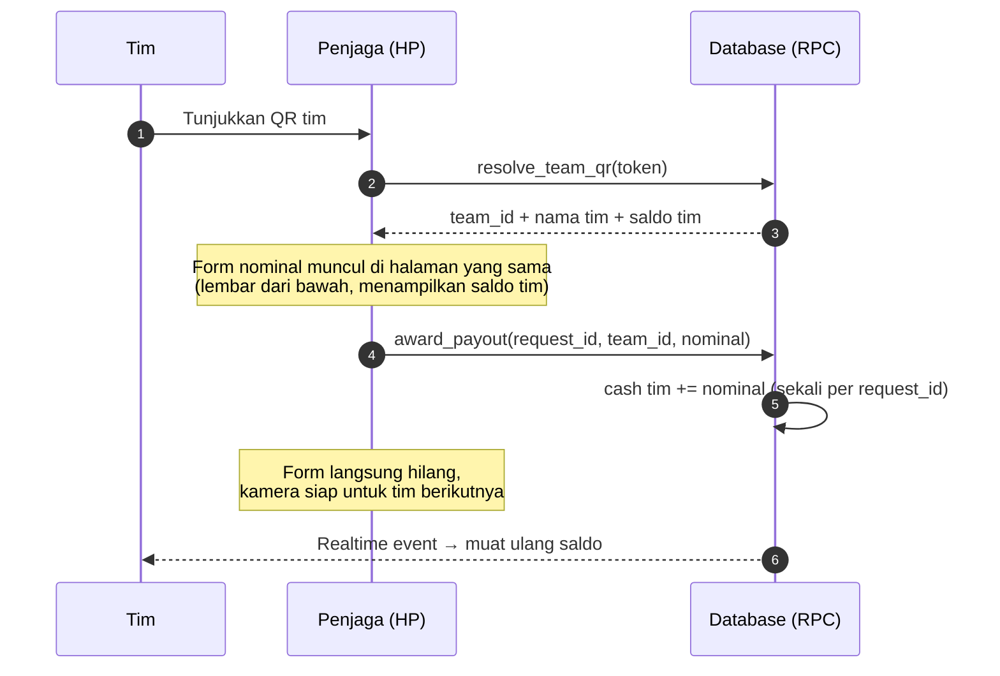

# 04 — Kontrak Fungsi Database (RPC)

Semua perubahan uang, stok, harga, dan status game **hanya** lewat fungsi di bawah. Klien tidak punya hak `insert/update/delete` langsung ke tabel (lihat [03-database](03-database.md#5-row-level-security-rls)).

Urutan blok `sql` pada dokumen ini adalah urutan eksekusi migrasi, setelah semua blok di [03-database](03-database.md).

## 1. Aturan umum untuk semua fungsi

1. `language plpgsql`, `security definer`, dan `set search_path = public` (mencegah pembajakan path).
2. Cek peran di awal dengan `app_role()`.
3. **Urutan kunci baris wajib seragam** (mencegah deadlock):
   `teams (urut id) → game_settings → news → assets (urut id)`.
   - Fungsi pasar (`buy_asset`, `sell_asset`, `process_market_cycle`, dan pemanggilnya `process_news_cycle`, `admin_set_game_state`) mengambil **`ob_lock()` paling awal** (kunci penasihat transaksi tunggal), lalu tim, lalu `game_settings`, `news`, aset. Nama `ob_lock` dipertahankan dari masa order book.
   - Fungsi yang mengubah uang tim (`buy_asset`, `sell_asset`, `award_payout`, `admin_adjust_cash`) **mengunci baris tim lebih dulu**.
   - `admin_set_game_state('finished')` mengunci **semua** baris tim (urut `id`) sebelum mengubah status. Akibatnya transaksi yang sedang berjalan selesai dulu, dan transaksi berikutnya melihat status `finished`. Tidak ada transaksi "nyelip" setelah leaderboard dibekukan.
   - Status game dibaca **setelah** kunci tim diambil (pernyataan terpisah, sehingga melihat data terbaru).
   - Fungsi berita (`process_news_cycle`, `admin_save_news`, `admin_set_news_ready`) mengunci `game_settings` lebih dulu, lalu `news`, lalu aset urut `id`.
4. Cek idempotensi (`request_id`) **setelah** kunci tim diambil, sehingga dua permintaan dengan `request_id` sama dari tim yang sama saling antre.
5. Error dilempar dengan `raise exception '<kode>'` (kode di [bagian 7](#7-error-code)). Pemanggilan fungsi adalah satu transaksi: error otomatis membatalkan semua perubahan di dalamnya.
6. Hak eksekusi dicabut dari `PUBLIC`/`anon` dan hanya diberikan ke `authenticated` di [bagian 6](#6-hak-eksekusi). Fungsi PostgreSQL secara bawaan bisa dipanggil `PUBLIC`; tanpa langkah itu, pengguna anonim bisa mencoba memanggilnya.

## 2. Ringkasan fungsi

| Fungsi | Peran | Status | Tujuan |
|--------|-------|--------|--------|
| `buy_asset(request_id, asset_id, qty)` | team | SQL + uji | Beli langsung pada harga tayang; batas pegang, stok, saldo |
| `sell_asset(request_id, asset_id, qty)` | team | SQL + uji | Jual langsung pada harga jual (tayang − selisih jual) |
| `get_analysis_offer()` | team | SQL + uji | Tawaran Analisa Pasar: harga, bisa beli, alasan, sudah dimiliki (tanpa waktu efek) |
| `buy_analysis(request_id)` | team | SQL + uji | Beli laporan analisa 4 paragraf untuk berita yang sedang tayang; sekali per berita per tim; idempoten ([18](18-analisa-pasar.md)) |
| `get_my_analyses(limit?)` | team | SQL + uji | Laporan yang sudah dibeli tim |
| `admin_set_analysis_settings(price, enabled)` | admin | SQL + uji | Harga dan saklar analisa; boleh kapan saja (tidak terkunci) |
| `admin_analysis_log(limit?)`, `admin_analysis_summary()` | admin | SQL + uji | Log pembelian dan ringkasan pendapatan, TANPA isi laporan |
| `get_market_summary()` | team, admin, display | SQL + uji | Acuan, harga tayang, harga jual, stok, tekanan, statistik transaksi per aset |
| `get_last_transactions(limit?)` | admin, display | SQL + uji | Transaksi terbaru tanpa nama tim |
| `admin_transaction_summary()` | admin | SQL + uji | Arus unit dan nilai per aset |
| `admin_set_trade_settings(...)` | admin | SQL + uji | Selisih jual, tekanan, batas pegang (sebelum game dimulai); selisih jual harus > tekanan per unit (`invalid_input`) |
| `get_market_index()` | team, admin, display | SQL + uji | IKC dan indeks sektor (bobot sama rata) |
| `process_market_cycle()` | internal / `pg_cron` (tiap 10 detik) | SQL + uji | Pulihkan tekanan stok, akhiri suspensi |
| `get_my_summary()` | team | SQL + uji | Saldo, nilai aset (harga tayang), net worth sendiri |
| `get_leaderboard()` | admin, display | SQL + uji | Peringkat. **Ditolak untuk tim dan penjaga** |
| `resolve_team_qr(qr_token)` | guard, admin | SQL + uji | QR → id, nama, dan **saldo** tim (saldo ditampilkan di form hadiah, diputuskan 16 Nov) |
| `resolve_team_code(code)` | guard, admin | SQL + uji | Kode cadangan → id, nama, dan saldo tim (tidak dipakai UI) |
| `award_payout(request_id, team_id, amount, note?)` | guard | SQL + uji | Beri hadiah: **saldo tim langsung bertambah**, tanpa persetujuan |
| `get_post_payouts(limit?)` | guard | SQL + uji | Riwayat hadiah yang diberikan pos sendiri |
| `guard_set_post_open(open)` | guard | SQL + uji | Penjaga membuka/menutup posnya sendiri (tombol Tersedia / Tidak tersedia) |
| `get_post_list()` | semua peran login | SQL + uji | Daftar pos (nama, lokasi, tersedia atau tidak) tanpa rentang hadiah |
| `admin_set_game_state(state)` | admin | SQL + uji | Pindah status game. Pembukaan pertama mengisi `started_at` dan mengunci harga, kumpulan, dan pengaturan berita |
| `admin_adjust_cash(team_id, delta, reason)` | admin | SQL + uji | Koreksi saldo |
| `admin_save_news(news_id?, title, body, effects)` | admin | SQL + uji | Simpan draf berita beserta efek per aset (divalidasi 4–7 aset). **Hanya sebelum game dibuka** (`game_started_locked` sesudahnya) |
| `admin_set_news_ready(news_id, ready)` | admin | SQL + uji | Masukkan / keluarkan berita dari kumpulan yang dipilih acak oleh sistem. **Hanya sebelum game dibuka** |
| `get_news_pool_status()` | admin | SQL + uji | Jumlah berita draf / siap / boleh terbit sekarang / live / terpakai |
| `log_kiosk_event(event, device?)` | team | SQL + uji | Catat login / logout perangkat trading |
| `news_would_hit_bounds(news_id)` | internal | SQL + uji | Apakah berita membuat harga menabrak batas |
| `admin_rotate_team_qr(team_id)` | admin | SQL + uji | Ganti QR tim |
| `admin_freeze_leaderboard()` / `admin_unfreeze_leaderboard()` | admin | SQL + uji | Bekukan / lepas leaderboard |
| `admin_set_leaderboard_visible(visible)` | admin | SQL + uji | Tampil/sembunyikan di layar publik |
| `check_news_effects(news_id)` | internal | SQL + uji | Validasi aturan efek berita |
| `process_news_cycle()` | internal / `pg_cron` (tiap 10 detik) | SQL + uji | Terapkan harga saat `effect_at` tiba, pilih berita acak dari kumpulan, undi jeda 3–15 menit. **Satu-satunya jalur yang mengubah harga setelah game dibuka** |
| `admin_set_stock`, `admin_set_post_open`, `admin_upsert_asset`, `admin_upsert_post`, `admin_set_news_settings` | admin | **Spesifikasi saja** | Lihat [3.9](#39-fungsi-admin-yang-baru-berupa-spesifikasi) |

Fungsi yang dihapus dari versi sebelumnya: `grant_post_payout` (diganti `award_payout`; alur pengajuan + ACC sempat ada lalu dihapus) dan `list_teams_for_guard` (penjaga tidak perlu daftar tim; ia memindai QR).

Pembuatan **akun** (profil, tim, penjaga, display) tidak lewat RPC. Itu dikerjakan skrip `create-accounts.ts` memakai service role, dijalankan lokal oleh panitia.

## 3. Fungsi inti (acuan implementasi)

### 3.1 Beli dan jual (model toko): `buy_asset`, `sell_asset`

Menggantikan order book (20 Nov 2026; lihat [17](17-trading-toko.md)). Kode lengkap: `scripts/sql/trading-shop.sql`; tes: `scripts/sql/test-trading-shop.sql` (54 pemeriksaan, rollback).

**Model harga.** `assets.price` = harga acuan (digeser berita). `assets.price_factor_bps` = tekanan stok. `assets.last_price` (dan `rank_price`) = **harga tayang** = `shop_price(price, factor)`, dijaga trigger `assets_tayang` setiap `price` atau `price_factor_bps` berubah (dibulatkan ke `price_step`, dibatasi min/maks aset). Harga jual = `shop_sell_price(harga tayang)` = tayang dikurangi `sell_spread_bps`, dibulatkan ke bawah ke `price_step`.

**`buy_asset(p_request_id uuid, p_asset_id uuid, p_qty int) returns transactions`** (peran `team`)

1. Peran `team`, masukan lengkap, `1 <= qty <= 100000` (`forbidden`, `invalid_input`).
2. `ob_lock()` (kunci penasihat tunggal pasar), kunci baris tim (`team_not_found`).
3. Idempoten: `request_id` sudah ada dengan parameter sama mengembalikan baris yang sama; parameter berbeda `request_id_conflict`.
4. Status game `open` (`market_closed`); aset aktif (`asset_not_found`, juga untuk aset bangkrut); tidak disuspensi (`asset_suspended`).
5. Batas pegang: `holding + qty <= max(1, floor(init_stock x hold_cap_pct / 100))` (`hold_cap_exceeded`); `qty <= stock` (`insufficient_stock`).
6. **Total = jumlah harga tiap unit** (sejak 23 Nov, `scripts/sql/trading-impact.sql`): unit ke-i (mulai 0) pada `shop_price(price, min(pressure_cap_bps, factor + i x pressure_bps_per_unit))`, jadi unit pertama = `last_price` dan tiap unit berikutnya satu langkah tekanan lebih mahal (menutup arbitrase beli lalu jual langsung). `unit_price` = total / qty (dibulatkan), `list_price` = `last_price` sebelum transaksi; `cash >= total` (`insufficient_cash`).
7. Efek (satu transaksi): saldo turun, `holdings` naik (`cost_basis` + total), `stock` turun, `price_factor_bps` naik `qty x pressure_bps_per_unit` (maks `pressure_cap_bps`), `last_trade_at`, baris `transactions`.

**`sell_asset(p_request_id, p_asset_id, p_qty)`** sama, kecuali: syarat `holding >= qty` (`insufficient_holdings`), total = jumlah harga jual tiap unit (unit ke-j pada `shop_sell_price(shop_price(price, max(-pressure_cap_bps, factor - j x pressure_bps_per_unit)))`; `qty = 1` = harga jual yang tampil), saldo naik, `cost_basis` berkurang proporsional, `stock` naik, tekanan turun.

**`transactions`**: `id`, `request_id` (unik), `team_id`, `asset_id`, `side` (`buy`/`sell`), `qty`, `unit_price`, `list_price`, `total`, `created_at`. RLS: tim membaca miliknya, admin semuanya; klien tidak bisa menulis.

**Pengaturan** (`game_settings`, dikunci setelah game dimulai): `sell_spread_bps` (200), `pressure_bps_per_unit` (20), `pressure_cap_bps` (1500), `pressure_decay_minutes` (10), `hold_cap_pct` (30), `stock_mid_pct` (50), `stock_low_pct` (20). Diubah lewat `admin_set_trade_settings(spread, pressure, cap, decay, hold_cap)`.

### 3.1a Fungsi baca dan siklus pasar

| Fungsi | Peran | Keterangan |
|--------|-------|-----------|
| `get_market_summary()` | team, admin, display | Per aset aktif: `ref_price`, `last_price` (tayang), `sell_price`, `stock`, `init_stock`, `price_factor_bps`, serta open/high/low/lot/val/avg/freq dari `transactions` |
| `get_market_snapshot()` | team | Satu `jsonb` untuk papan Pasar tim: `game` (8 kolom `game_settings`), `assets` (aset aktif), `summary` (= `get_market_summary()`), `day_open` (= `get_day_open_prices()`), `bankrupt` (= `get_bankrupt_notices()`), `holdings` (kepemilikan tim pemanggil, `qty > 0`), `analysis` (= `get_analysis_offer()`, satu baris atau `null`). *Security invoker* (RLS tetap berlaku untuk `holdings`), satu pernyataan = satu snapshot database. Menggantikan 7 panggilan polling 5 detik; `scripts/sql/market-snapshot.sql`, uji `scripts/sql/test-market-snapshot.sql`. Aplikasi jatuh ke 7 panggilan lama bila fungsi ini belum ada di database |
| `get_last_transactions(limit)` | admin, display | Transaksi terbaru (simbol, sisi, qty, harga satuan, waktu), tanpa nama tim |
| `admin_transaction_summary()` | admin | Per aset: unit dibeli, dijual, nilai, jumlah transaksi (seluruh transaksi) |
| `get_my_summary()` | team | `cash`, `holdings_value`, `net_worth` (nilai aset = qty x harga tayang) |
| `process_market_cycle()` | internal / `pg_cron` tiap 10 dtk | Menjalankan `process_suspensions()` dan memulihkan tekanan stok menuju 0 secara linear (`ceil(cap x detik / (menit x 60))` bps per siklus; jam di tabel `shop_clock`; berhenti saat pasar dijeda) |

`bankrupt_asset` dan `suspend_asset` tidak lagi menyentuh order: bangkrut melikuidasi unit tim ke saldo (`liquidation_price`) dan menonaktifkan aset; suspensi mengisi `suspended_until`. Kolom lama (`fee_bps`, `band_bps`, `house_*`, `rank_*`, `locked_*`) dibuang oleh `scripts/sql/trading-shop-cleanup.sql`.

### 3.2 Alur hadiah pos: kartu QR → hadiah langsung masuk



```sql
create or replace function public.resolve_team_qr(p_qr uuid)
returns public.team_ref
language plpgsql stable security definer set search_path = public
as $$
declare v_ref public.team_ref;
begin
  if coalesce(app_role()::text, '') not in ('guard', 'admin') then raise exception 'forbidden'; end if;
  select t.id, t.name, t.cash into v_ref from teams t where t.qr_token = p_qr;
  if v_ref.team_id is null then raise exception 'team_not_found'; end if;
  return v_ref;
end $$;

create or replace function public.resolve_team_code(p_code text)
returns public.team_ref
language plpgsql stable security definer set search_path = public
as $$
declare v_ref public.team_ref;
begin
  if coalesce(app_role()::text, '') not in ('guard', 'admin') then raise exception 'forbidden'; end if;
  select t.id, t.name, t.cash into v_ref from teams t where t.short_code = upper(btrim(p_code));
  if v_ref.team_id is null then raise exception 'team_not_found'; end if;
  return v_ref;
end $$;
```

Pemeriksaan daftar peran memakai `coalesce(app_role()::text, '')`. Tanpa `coalesce`, `app_role() not in (...)` bernilai `NULL` untuk pengguna tanpa profil, `if` tidak masuk, dan pemeriksaan bocor.

```sql
create or replace function public.award_payout(
  p_request_id uuid,
  p_team_id    uuid,
  p_amount     bigint,
  p_note       text default null
) returns public.payouts
language plpgsql security definer set search_path = public
as $$
declare
  v_uid      uuid := auth.uid();
  v_post     public.posts;
  v_state    game_state;
  v_existing public.payouts;
  v_row      public.payouts;
begin
  if app_role() is distinct from 'guard' then raise exception 'forbidden'; end if;

  select * into v_post from posts where guard_id = v_uid;
  if not found then raise exception 'forbidden'; end if;

  -- kunci tim tujuan: menserialkan hadiah dengan transaksi dan dengan penutupan game
  perform 1 from teams where id = p_team_id for update;
  if not found then raise exception 'team_not_found'; end if;

  -- idempotensi: kirim ulang dari antrean offline mengembalikan hasil lama
  select * into v_existing from payouts where request_id = p_request_id;
  if found then
    if v_existing.guard_id = v_uid and v_existing.team_id = p_team_id
       and v_existing.amount = p_amount then
      return v_existing;
    end if;
    raise exception 'request_id_conflict';
  end if;

  select state into v_state from game_settings;
  if v_state not in ('open', 'paused') then raise exception 'game_not_active'; end if;
  if not v_post.is_open then raise exception 'post_closed'; end if;

  -- satu-satunya pemeriksaan nominal: bilangan bulat positif (tanpa batas atas, diputuskan)
  if p_amount is null or p_amount < 1 then raise exception 'invalid_amount'; end if;

  insert into payouts (request_id, post_id, team_id, guard_id, amount, note)
  values (p_request_id, v_post.id, p_team_id, v_uid, p_amount, p_note)
  on conflict (request_id) do nothing
  returning * into v_row;
  if not found then raise exception 'request_id_conflict'; end if;

  update teams set cash = cash + p_amount where id = p_team_id;

  insert into audit_log (actor_id, action, payload)
  values (v_uid, 'payout_awarded',
          jsonb_build_object('payout_id', v_row.id, 'team_id', p_team_id,
                             'post_id', v_post.id, 'amount', p_amount));
  return v_row;
end $$;

create or replace function public.get_post_payouts(p_limit int default 50)
returns setof public.post_payout_row
language plpgsql stable security definer set search_path = public
as $$
begin
  if app_role() is distinct from 'guard' then raise exception 'forbidden'; end if;
  return query
    select pr.id, t.name, pr.amount, pr.created_at
      from payouts pr
      join teams t on t.id = pr.team_id
      join posts p on p.id = pr.post_id
     where p.guard_id = auth.uid()
     order by pr.created_at desc
     limit least(greatest(coalesce(p_limit, 50), 1), 200);
end $$;

create or replace function public.guard_set_post_open(p_open boolean)
returns boolean
language plpgsql security definer set search_path = public
as $$
declare
  v_uid   uuid := auth.uid();
  v_post  public.posts;
  v_state game_state;
begin
  if app_role() is distinct from 'guard' then raise exception 'forbidden'; end if;
  if p_open is null then raise exception 'invalid_argument'; end if;

  -- kunci baris pos sendiri; satu penjaga hanya bisa mengubah posnya
  select * into v_post from posts where guard_id = v_uid for update;
  if not found then raise exception 'forbidden'; end if;

  select state into v_state from game_settings;
  if v_state = 'finished' then raise exception 'game_not_active'; end if;

  if v_post.is_open is distinct from p_open then
    update posts set is_open = p_open where id = v_post.id;
    insert into audit_log (actor_id, action, payload)
    values (v_uid, 'guard_set_post_open',
            jsonb_build_object('post_id', v_post.id, 'is_open', p_open));
  end if;
  return p_open;
end $$;

create or replace function public.get_post_list()
returns table (id uuid, name text, location text, is_open boolean)
language plpgsql stable security definer set search_path = public
as $$
begin
  if app_role() is null then raise exception 'forbidden'; end if;
  return query select p.id, p.name, p.location, p.is_open from posts p order by p.name;
end $$;
```

Poin penting:

- Pos ditentukan dari **akun penjaga yang login**, bukan dari parameter. Penjaga tidak bisa memberi hadiah atas nama pos lain.
- **Saldo berubah seketika** di `award_payout`. Tidak ada persetujuan, tidak ada batas nominal atas, tidak ada batas kunjungan (diputuskan panitia: tanpa pengaman). Konsekuensinya: nominal yang salah ketik atau penjaga yang curang langsung berpengaruh; satu-satunya pemulihan adalah admin memakai `admin_adjust_cash` sesudahnya, dan jejaknya ada di `audit_log` (`payout_awarded`) dan tabel `payouts`.
- Yang tetap diperiksa hanya syarat teknis: peran penjaga, tim ada, game `open`/`paused`, pos sedang tersedia, nominal bilangan bulat positif.
- Idempotensi lewat `request_id` tetap ada: dua kali kirim dengan id yang sama menambah saldo **sekali** (bukan pengaman kecurangan, tetapi supaya antrean lokal yang mengirim ulang atau tombol yang tertekan dua kali tidak menggandakan uang).
- Penjaga hanya melihat saldo tim **yang kartunya baru dipindainya**: `resolve_team_*` mengembalikan id, nama, dan saldo saat itu (revisi 16 Nov; sebelumnya hanya id dan nama). Penjaga tetap tidak punya akses baca ke tabel `teams`, tidak bisa melihat daftar tim, saldo tim lain, atau peringkat. Saldo itu adalah angka sesaat dan tidak dipakai membatasi nominal (tidak ada batas nominal).
- Setelah `finished`, hadiah ditolak (`game_not_active`) supaya leaderboard beku tidak bergeser.

### 3.3 Status game, pembekuan leaderboard, dan leaderboard publik

> Catatan 20 Nov: kode di bagian ini dan §3.4 masih memanggil `ob_cancel_all` dan `process_house_quotes` (order book lama). Keduanya sudah dibuang; versi yang berlaku ada di `scripts/sql/trading-shop.sql` (`admin_set_game_state` memanggil `shop_init_assets()` saat dibuka; tidak ada pembatalan order saat selesai).

```sql
create or replace function public.freeze_leaderboard_internal()
returns void
language plpgsql security definer set search_path = public
as $$
begin
  delete from leaderboard_snapshot where true;
  insert into leaderboard_snapshot (team_id, rank, cash, holdings_value, net_worth)
  select v.team_id,
         (rank() over (order by v.net_worth desc, v.cash desc))::int,
         v.cash, v.holdings_value, v.net_worth
    from v_team_net_worth v;
  update game_settings set leaderboard_frozen_at = now(), updated_at = now();
end $$;

create or replace function public.admin_set_game_state(
  p_state game_state
) returns game_state
language plpgsql security definer set search_path = public
as $$
declare
  v_uid     uuid := auth.uid();
  v_cur     game_state;
  v_news    int;
  v_paused  timestamptz;
  v_shift   interval;
begin
  if app_role() is distinct from 'admin' then raise exception 'forbidden'; end if;
  perform public.ob_lock();                          -- urutan kunci: ob_lock lebih dulu (lihat 3.1)

  -- menutup game: kunci SEMUA tim (urut id) agar tidak ada transaksi nyelip
  if p_state = 'finished' then
    perform 1 from teams order by id for update;
  end if;

  select state, paused_at into v_cur, v_paused from game_settings for update;

  if not ((v_cur = 'setup'  and p_state = 'open')
       or (v_cur = 'open'   and p_state in ('paused', 'finished'))
       or (v_cur = 'paused' and p_state in ('open', 'finished'))) then
    raise exception 'invalid_state_transition';
  end if;

  if p_state = 'finished' then
    -- berita yang sudah tayang tapi harganya belum berubah: tidak boleh dibatalkan siapa pun, tunggu sampai berlaku
    select count(*) into v_news from news where status = 'live';
    if v_news > 0 then
      raise exception 'news_pending';
    end if;
    perform public.ob_cancel_all();                  -- pasar ditutup: semua order antre dibatalkan, kunci dikembalikan
    perform set_config('classmeet.system', 'off', true);
    perform public.freeze_leaderboard_internal();
  end if;

  -- jeda: timer efek dan jeda berita ikut berhenti. Saat dilanjutkan, semua tenggat digeser
  -- sebesar lamanya jeda, sehingga sisa waktu tidak berubah.
  if p_state = 'open' and v_cur = 'paused' and v_paused is not null then
    v_shift := now() - v_paused;
    perform set_config('classmeet.system', 'on', true);                 -- pergeseran waktu oleh sistem, bukan pengaturan panitia
    update news set effect_at = effect_at + v_shift where status = 'live';
    perform set_config('classmeet.system', 'off', true);
    update game_settings set news_next_allowed_at = news_next_allowed_at + v_shift
     where news_next_allowed_at is not null;
  end if;

  update game_settings
     set state = p_state,
         paused_at = case when p_state = 'paused' then now() else null end,
         started_at = case when v_cur = 'setup' and p_state = 'open' then now() else started_at end,  -- terkunci sejak pembukaan pertama
         updated_at = now();

  insert into audit_log (actor_id, action, payload)
  values (v_uid, 'set_state', jsonb_build_object('from', v_cur, 'to', p_state));

  -- pasar dibuka / dilanjutkan: siklus langsung berjalan (memilih berita dari kumpulan bila jeda sudah lewat)
  if p_state = 'open' then
    perform public.process_news_cycle();
    perform public.process_house_quotes();           -- bandar memasang kuotasi saat pasar dibuka / dilanjutkan
  end if;
  return p_state;
end $$;

create or replace function public.admin_freeze_leaderboard() returns void
language plpgsql security definer set search_path = public
as $$
begin
  if app_role() is distinct from 'admin' then raise exception 'forbidden'; end if;
  perform public.freeze_leaderboard_internal();
  insert into audit_log (actor_id, action, payload) values (auth.uid(), 'freeze_leaderboard', '{}'::jsonb);
end $$;

create or replace function public.admin_unfreeze_leaderboard() returns void
language plpgsql security definer set search_path = public
as $$
begin
  if app_role() is distinct from 'admin' then raise exception 'forbidden'; end if;
  delete from leaderboard_snapshot where true;
  update game_settings set leaderboard_frozen_at = null, updated_at = now();
  insert into audit_log (actor_id, action, payload) values (auth.uid(), 'unfreeze_leaderboard', '{}'::jsonb);
end $$;

create or replace function public.admin_set_leaderboard_visible(p_visible boolean) returns void
language plpgsql security definer set search_path = public
as $$
begin
  if app_role() is distinct from 'admin' then raise exception 'forbidden'; end if;
  if p_visible is null then raise exception 'invalid_input'; end if;
  update game_settings set leaderboard_visible = p_visible, updated_at = now();
  insert into audit_log (actor_id, action, payload)
  values (auth.uid(), 'leaderboard_visible', jsonb_build_object('visible', p_visible));
end $$;

create or replace function public.get_leaderboard()
returns setof public.leaderboard_row
language plpgsql security definer set search_path = public
as $$
declare
  v_role    app_role := app_role();
  v_visible boolean;
  v_frozen  timestamptz;
begin
  -- Leaderboard tampil di ruang publik. Akun tim dan penjaga TIDAK boleh memanggilnya.
  if v_role is null or v_role not in ('admin', 'display') then raise exception 'forbidden'; end if;

  select leaderboard_visible, leaderboard_frozen_at into v_visible, v_frozen from game_settings;

  if v_role = 'display' and not v_visible then raise exception 'leaderboard_hidden'; end if;

  if v_role = 'display' and v_frozen is not null then
    return query
      select s.rank, s.team_id, t.name, s.cash, s.holdings_value, s.net_worth
        from leaderboard_snapshot s join teams t on t.id = s.team_id
       order by s.rank, t.name;
    return;
  end if;

  return query
    select (rank() over (order by v.net_worth desc, v.cash desc))::int,
           v.team_id, v.name, v.cash, v.holdings_value, v.net_worth
      from v_team_net_worth v
     order by 1, v.name;
end $$;

create or replace function public.get_my_summary()
returns public.my_summary
language plpgsql stable security definer set search_path = public
as $$
declare v_row public.my_summary;
begin
  if app_role() is distinct from 'team' then raise exception 'forbidden'; end if;
  select v.avail_cash, v.holdings_value, v.net_worth, v.locked_cash into v_row
    from v_team_net_worth v where v.team_id = auth.uid();
  return v_row;
end $$;
```

- `display` melihat peringkat langsung (atau snapshot bila dibekukan, atau error `leaderboard_hidden` bila disembunyikan). Admin selalu melihat data langsung.
- Seri: `net_worth` menurun, lalu `cash` menurun; jika masih sama, peringkat dibagi.
- **`holdings_value` dan `net_worth` memakai harga beli** (`cost_basis`, lihat [03 §4](03-database.md#4-kalkulasi-net-worth)). Layar publik mengambil seluruh hasil lalu menampilkan **5 baris pertama** di klien; admin melihat semuanya.
- `get_my_summary()` hanya saldo, nilai aset, dan net worth **milik sendiri**. Tidak ada peringkat.

> **Diganti 19 Nov:** `process_news_cycle()` kini memilih lewat `pick_next_news()` menurut kondisi pasar dan peluang event; lihat [15-mesin-berita-v2](15-mesin-berita-v2.md). Isi di bawah adalah versi lama.

### 3.4 Siklus berita: kumpulan, pemilihan acak berbatas, efek tertunda, dan jeda

Tidak ada pergerakan harga acak oleh peserta atau panitia. **Satu-satunya** hal yang mengubah harga adalah efek berita yang dipilih **sistem** dari kumpulan berita `ready`. Sejak game dibuka, **panitia tidak punya jalur apa pun** untuk mengubah harga, memilih berita, menyusun urutan, menambah/mengubah berita, atau membatalkannya (keputusan 17 Nov). Siklusnya:

```
berita terbit ──jeda ACAK 3–15 mnt──► harga berubah ──jeda antar-berita (default 0)──► berita berikutnya terpilih
 (published_at)   diundi sistem          (effect_at)                                     (news_next_allowed_at)
```

Jeda acak diundi **per berita saat terbit**, dalam detik, antara `news_delay_min_minutes` (3) dan `news_delay_max_minutes` (15) dikurangi 10 detik (penjadwal berjalan tiap 10 detik, sehingga perubahan nyata tidak melewati 15 menit). Nilainya hanya ada di `news.effect_at`, yang tidak terbaca siapa pun selama game berjalan. Tim tahu ada berita, tetapi tidak tahu berapa lama waktu yang mereka punya sebelum harga berubah. Hanya satu berita `live` pada satu waktu. Saat jeda antar-berita habis dan pasar `open`, sistem memilih acak satu berita `ready`: calon yang lolos `news_would_hit_bounds` didahulukan; bila **tidak ada** yang lolos, sistem tetap memilih satu secara acak dan harga dijepit di `min_price`/`max_price` (panitia tidak bisa lagi menggeser harga, jadi pasar tidak boleh macet). Bila kumpulan `ready` kosong, siklus berhenti sampai game selesai.

Rentang jeda dan jeda antar-berita ada di `game_settings` (`news_delay_min_minutes`, `news_delay_max_minutes`, `news_gap_minutes`) dan terkunci sejak game dibuka. Aturan jumlah aset (4–7) dan batas efek (±15 %) ada di kolom `min_news_assets`, `max_news_assets`, `max_effect_bps`.

#### Validasi

```sql
create or replace function public.check_news_effects(p_news_id uuid)
returns void
language plpgsql stable security definer set search_path = public
as $$
declare
  v_min int; v_max int; v_cap int;
  v_n int; v_active int; v_bad int;
begin
  select min_news_assets, max_news_assets, max_effect_bps into v_min, v_max, v_cap from game_settings;

  select count(*),
         count(*) filter (where a.is_active),
         count(*) filter (where e.pct_bps = 0 or abs(e.pct_bps) > v_cap)
    into v_n, v_active, v_bad
    from news_effects e join assets a on a.id = e.asset_id
   where e.news_id = p_news_id;

  if v_n < v_min or v_n > v_max then raise exception 'news_invalid_effects'; end if;
  if v_active <> v_n then raise exception 'news_invalid_effects'; end if;   -- ada aset nonaktif
  if v_bad > 0 then raise exception 'news_invalid_effects'; end if;         -- nol atau melebihi batas
end $$;
```

Aturan ini diperiksa **dua kali**: saat disimpan (`admin_save_news`, hanya sebelum game dibuka) dan saat diluncurkan oleh `process_news_cycle`.

#### Simpan dan tandai siap (hanya sebelum game dibuka)

```sql
create or replace function public.admin_save_news(
  p_news_id uuid,            -- null = berita baru
  p_title   text,
  p_body    text,
  p_effects jsonb            -- [{"asset_id": "...", "pct_bps": 500}, ...]
) returns uuid
language plpgsql security definer set search_path = public
as $$
declare
  v_id     uuid;
  v_status news_status;
  e        jsonb;
begin
  if app_role() is distinct from 'admin' then raise exception 'forbidden'; end if;
  if public.game_is_locked() then raise exception 'game_started_locked'; end if;   -- kumpulan terkunci sejak pembukaan pertama
  if p_title is null or btrim(p_title) = '' or p_body is null or btrim(p_body) = ''
     or p_effects is null or jsonb_typeof(p_effects) <> 'array' then
    raise exception 'invalid_input';
  end if;

  if p_news_id is null then
    insert into news (title, body, created_by)
    values (btrim(p_title), btrim(p_body), auth.uid())
    returning id into v_id;
  else
    select id, status into v_id, v_status from news where id = p_news_id for update;
    if not found then raise exception 'news_not_found'; end if;
    if v_status <> 'draft' then raise exception 'news_wrong_status'; end if;   -- antre/tayang tidak boleh diubah
    update news set title = btrim(p_title), body = btrim(p_body) where id = v_id;
    delete from news_effects where news_id = v_id;
  end if;

  for e in select * from jsonb_array_elements(p_effects) loop
    if (e->>'asset_id') is null or (e->>'pct_bps') is null then raise exception 'invalid_input'; end if;
    if exists (select 1 from news_effects where news_id = v_id and asset_id = (e->>'asset_id')::uuid) then
      raise exception 'news_invalid_effects';                                 -- aset ganda
    end if;
    insert into news_effects (news_id, asset_id, pct_bps)
    values (v_id, (e->>'asset_id')::uuid, (e->>'pct_bps')::int);
  end loop;

  perform public.check_news_effects(v_id);       -- gagal = seluruh penyimpanan dibatalkan
  insert into audit_log (actor_id, action, payload)
  values (auth.uid(), 'save_news', jsonb_build_object('news_id', v_id));
  return v_id;
end $$;

```

#### Kumpulan berita dan pemilih acak berbatas

Admin tidak memilih berita berikutnya dan tidak menentukan urutannya. **Sebelum game dibuka** admin menulis berita (`draft`), memeriksanya, lalu menandainya **siap** (`ready`). Setelah pasar dibuka pertama kali kumpulan terkunci. Sistem memilih satu berita `ready` secara acak (`order by random()`) tiap kali jeda habis dan pasar `open`; calon yang membuat harga menabrak batas didahulukan terakhir (lihat di atas). Berita yang sudah terpilih tidak kembali ke kumpulan.

```sql
create or replace function public.admin_set_news_ready(p_news_id uuid, p_ready boolean)
returns void
language plpgsql security definer set search_path = public
as $$
declare
  v_state  game_state;
  v_status news_status;
begin
  if app_role() is distinct from 'admin' then raise exception 'forbidden'; end if;
  if p_ready is null then raise exception 'invalid_input'; end if;
  if public.game_is_locked() then raise exception 'game_started_locked'; end if;

  select state into v_state from game_settings for update;          -- game_settings dulu, lalu news
  if v_state = 'finished' then raise exception 'game_finished'; end if;

  select status into v_status from news where id = p_news_id for update;
  if not found then raise exception 'news_not_found'; end if;

  if p_ready then
    if v_status <> 'draft' then raise exception 'news_wrong_status'; end if;
    perform public.check_news_effects(p_news_id);                   -- valid sekarang, diperiksa lagi saat terbit
    update news set status = 'ready' where id = p_news_id;
  else
    if v_status <> 'ready' then raise exception 'news_wrong_status'; end if;
    update news set status = 'draft' where id = p_news_id;
  end if;

  insert into audit_log (actor_id, action, payload)
  values (auth.uid(), 'set_news_ready', jsonb_build_object('news_id', p_news_id, 'ready', p_ready));
end $$;

-- Internal: apakah menerapkan berita ini sekarang membuat harga aset aktif mana pun menabrak batas?
create or replace function public.news_would_hit_bounds(p_news_id uuid)
returns boolean
language sql stable security definer set search_path = public
as $$
  select exists (
    select 1
      from news_effects e
      join assets a on a.id = e.asset_id
      join game_settings g on true
     where e.news_id = p_news_id and a.is_active
       and (((a.price * (10000 + e.pct_bps)) / 10000 + g.price_step / 2) / g.price_step) * g.price_step
           not between a.min_price and a.max_price
  );
$$;

create or replace function public.get_news_pool_status()
returns table (draft_count int, ready_count int, eligible_count int, live_count int, applied_count int)
language plpgsql stable security definer set search_path = public
as $$
begin
  if app_role() is distinct from 'admin' then raise exception 'forbidden'; end if;
  return query select
    (select count(*)::int from news where status = 'draft'),
    (select count(*)::int from news where status = 'ready'),
    (select count(*)::int from news where status = 'ready' and not public.news_would_hit_bounds(id)),
    (select count(*)::int from news where status = 'live'),
    (select count(*)::int from news where status = 'applied');
end $$;
```

- `eligible_count` = berita `ready` yang boleh terbit **sekarang**. Panel admin memberi peringatan bila `ready_count = 0` atau `eligible_count = 0` saat pasar buka, karena itu berarti pasar akan diam sampai ada berita baru atau harga bergeser.
- `eligible_count` = berita `ready` yang tidak membuat harga menabrak batas **sekarang**. Panel admin sebelum game dibuka memberi peringatan bila `ready_count` kurang dari kebutuhan (±220 untuk 3 hari). Sesudah game dibuka tidak ada yang bisa menambah berita: bila kumpulan habis, harga berhenti berubah sampai game selesai, jadi siapkan kumpulan yang lebih besar dari kebutuhan.
- Pemeriksaan batas dilakukan saat terbit. Karena panitia tidak bisa mengubah harga, harga di saat terbit sama dengan harga di saat efek diterapkan; penjepit (`greatest/least`) tetap menjaga batas.

#### Mesin siklus

```sql
create or replace function public.process_news_cycle()
returns text
language plpgsql security definer set search_path = public
as $$
declare
  v_state   game_state;
  v_dmin    int;
  v_dmax    int;
  v_gap     int;
  v_allowed timestamptz;
  v_step    int;
  v_live    public.news;
  v_pick    public.news;
  r         record;
  v_new     bigint;
  v_found   boolean;
  v_secs    int;
  v_result  text := 'idle';
begin
  perform public.ob_lock();                         -- urutan kunci: ob_lock lebih dulu (lihat 3.1)
  select state, news_delay_min_minutes, news_delay_max_minutes, news_gap_minutes, news_next_allowed_at, price_step
    into v_state, v_dmin, v_dmax, v_gap, v_allowed, v_step
    from game_settings for update;                  -- serialisasi: dua pemanggil tidak menerapkan dua kali
  if v_state <> 'open' then return 'idle'; end if;  -- jeda dan selesai membekukan siklus

  perform set_config('classmeet.system', 'on', true);   -- hanya fungsi ini yang boleh mengubah harga dan berita sesudah game dibuka

  -- 1) terapkan efek berita yang waktunya sudah tiba
  select * into v_live from news where status = 'live' for update;
  if found and v_live.effect_at <= now() then
    for r in
      select e.asset_id, e.pct_bps from news_effects e
       where e.news_id = v_live.id order by e.asset_id
    loop
      update assets
         set price = greatest(min_price, least(max_price,
               (((price * (10000 + r.pct_bps)) / 10000 + v_step / 2) / v_step) * v_step))
       where id = r.asset_id and is_active
       returning price into v_new;
      get diagnostics v_found = row_count;
      if v_found then
        update assets set last_price = price, rank_price = price where id = r.asset_id;   -- harga tampil dan peringkat menyusul acuan baru
        insert into price_history (asset_id, price, news_id, reason)
        values (r.asset_id, v_new, v_live.id, 'berita');
      end if;
    end loop;

    update news set status = 'applied', effect_applied_at = now() where id = v_live.id;
    v_allowed := now() + make_interval(mins => v_gap);
    update game_settings set news_next_allowed_at = v_allowed, updated_at = now();
    v_result := 'applied';
    v_live := null;
  elsif found then
    perform set_config('classmeet.system', 'off', true);
    return 'waiting';                               -- efek belum jatuh tempo
  end if;

  -- 2) pilih berita acak dari kumpulan `ready` bila jeda antar-berita sudah habis.
  --    Calon yang aman bagi batas harga didahulukan; bila tidak ada, pilih acak dari semua yang `ready`
  --    (harga dijepit di batas) agar pasar tidak macet, karena panitia tidak bisa memperbaiki harga.
  if v_allowed is null or now() >= v_allowed then
    select * into v_pick from news
     where status = 'ready' and not public.news_would_hit_bounds(id)
     order by random() limit 1 for update;
    if not found then
      select * into v_pick from news where status = 'ready' order by random() limit 1 for update;
    end if;
    if found then
      begin
        perform public.check_news_effects(v_pick.id);
        -- jeda acak dalam DETIK: min..(maks - 10 dtk), karena penjadwal berjalan tiap 10 dtk
        v_secs := v_dmin * 60 + floor(random() * (greatest(v_dmax * 60 - 10, v_dmin * 60) - v_dmin * 60 + 1))::int;
        update news
           set status = 'live', published_at = now(),
               effect_at = now() + make_interval(secs => v_secs)
         where id = v_pick.id;
        insert into news_feed (news_id, title, body, published_at)
        select id, title, body, published_at from news where id = v_pick.id;
        v_result := case when v_result = 'applied' then 'applied+launched' else 'launched' end;
      exception when others then
        -- aturan tidak lagi terpenuhi: kembalikan ke draf dan catat; jangan macet
        update news set status = 'draft' where id = v_pick.id;
        insert into audit_log (action, payload)
        values ('news_launch_failed', jsonb_build_object('news_id', v_pick.id));
      end;
    end if;
  end if;
  if v_result like 'applied%' then
    perform public.process_house_quotes();          -- bandar memusatkan kuotasi ke acuan baru
  end if;
  perform set_config('classmeet.system', 'off', true);
  return v_result;
end $$;
```

Penjadwalan dengan `pg_cron` (tiap menit; fungsi yang memutuskan apakah ada yang harus dikerjakan):

```sql
-- [lewati-uji] hanya di Supabase (butuh ekstensi pg_cron)
create extension if not exists pg_cron;
select cron.schedule('news-cycle', '10 seconds', $$select public.process_news_cycle()$$);   -- pg_cron >= 1.5 mendukung interval detik
select cron.schedule('market-cycle', '10 seconds', $$select public.process_market_cycle()$$);  -- kuotasi bandar: isi ulang tiap house_refresh_seconds
```

Catatan perilaku:

- **Jeda (`paused`)** menghentikan semuanya: efek tidak diterapkan dan jeda antar-berita tidak berjalan. Saat dilanjutkan, `effect_at` berita yang sedang tayang dan `news_next_allowed_at` digeser sebesar lamanya jeda, sehingga sisa waktu tetap sama. Pergeseran dilakukan sistem (penanda `classmeet.system`), bukan pengaturan panitia.
- **Ketepatan ±10 detik** (penjadwal `pg_cron` tiap 10 detik). Undian dibatasi sampai 14 menit 50 detik, jadi perubahan nyata tidak melewati 15 menit.
- **Tidak ada tombol cadangan.** Fungsi `admin_run_news_cycle` dihapus: panitia tidak boleh memicu atau memajukan siklus. Bila `pg_cron` bermasalah, jalankan `process_news_cycle()` dari jadwal luar (pekerja server dengan kunci layanan) tiap 10 detik, dan catat di log operasi.
- **Menutup game** saat ada berita `live` ditolak (`news_pending`); tidak ada opsi paksa. Tunggu harga terakhir berubah (paling lama 15 menit), lalu tekan Selesai.
- **Tidak ada pengaturan "cooldown aset"**; penjaga satu-satunya adalah batas harga min/maks.
- Harga yang berubah muncul di klien lewat Realtime pada tabel `assets`.

### 3.5 Koreksi saldo dan QR

```sql
create or replace function public.admin_adjust_cash(
  p_team_id uuid,
  p_delta   bigint,
  p_reason  text
) returns bigint
language plpgsql security definer set search_path = public
as $$
declare
  v_before bigint;
  v_after  bigint;
begin
  if app_role() is distinct from 'admin' then raise exception 'forbidden'; end if;
  if p_delta is null or p_delta = 0 or p_reason is null or btrim(p_reason) = '' then
    raise exception 'invalid_input';
  end if;

  select cash into v_before from teams where id = p_team_id for update;
  if not found then raise exception 'team_not_found'; end if;
  if v_before + p_delta < 0 then raise exception 'insufficient_cash'; end if;

  update teams set cash = cash + p_delta where id = p_team_id returning cash into v_after;

  insert into audit_log (actor_id, action, payload)
  values (auth.uid(), 'adjust_cash',
          jsonb_build_object('team_id', p_team_id, 'delta', p_delta,
                             'before', v_before, 'after', v_after, 'reason', p_reason));
  return v_after;
end $$;

create or replace function public.admin_rotate_team_qr(p_team_id uuid)
returns uuid
language plpgsql security definer set search_path = public
as $$
declare v_new uuid;
begin
  if app_role() is distinct from 'admin' then raise exception 'forbidden'; end if;
  update teams set qr_token = gen_random_uuid() where id = p_team_id returning qr_token into v_new;
  if not found then raise exception 'team_not_found'; end if;
  insert into audit_log (actor_id, action, payload)
  values (auth.uid(), 'rotate_qr', jsonb_build_object('team_id', p_team_id));
  return v_new;
end $$;
```

### 3.5.1 Log perangkat trading

Tim masuk di perangkat trading panitia dengan memindai QR (lihat 07). Peserta memanggil fungsi ini sesudah login dan sebelum keluar supaya ada jejak siapa memakai perangkat mana, kapan.

```sql
create or replace function public.log_kiosk_event(p_event text, p_device text default null)
returns void
language plpgsql security definer set search_path = public
as $$
begin
  if app_role() is distinct from 'team' then raise exception 'forbidden'; end if;
  if p_event is null or p_event not in ('login', 'logout', 'idle_logout')
     or length(coalesce(p_device, '')) > 40 then
    raise exception 'invalid_input';
  end if;
  insert into audit_log (actor_id, action, payload)
  values (auth.uid(), 'kiosk_' || p_event, jsonb_build_object('device', p_device));
end $$;
```

### 3.6 Format `effects` untuk `admin_save_news`

```json
[
  { "asset_id": "uuid-aset-1", "pct_bps": 500 },
  { "asset_id": "uuid-aset-2", "pct_bps": -400 },
  { "asset_id": "uuid-aset-3", "pct_bps": 1200 },
  { "asset_id": "uuid-aset-4", "pct_bps": 300 }
]
```

`pct_bps` 100 = 1 %. Jumlah elemen 4–7, tidak ada `asset_id` ganda, tiap angka tidak nol dan tidak melebihi ±1500 (default). Pedoman isi (bukan batasan kode): perubahan biasa 8–14 % (800–1400). Batas kode tetap ±15 % (1500).

### 3.7 (dikosongkan)

Nomor bagian dipertahankan agar tautan dari dokumen lain tidak bergeser.

### 3.8 Hak baca ringkas

| Yang ingin dilihat | Peran | Cara |
|--------------------|-------|------|
| Saldo sendiri | team | `get_my_summary()` |
| Portofolio, riwayat transaksi sendiri | team | `select` langsung (dibatasi RLS) |
| Hadiah yang diterima sendiri | team | `select` pada `payouts` (RLS) |
| Peringkat semua tim | admin, display | `get_leaderboard()` |
| Daftar hadiah yang diberikan pos sendiri | guard | `get_post_payouts()` |
| Semua hadiah | admin | `select` pada `payouts` |
| Berita yang sudah tayang | semua yang login | `select` pada `news` (RLS: hanya yang `published_at` terisi) |
| Rincian tim (kas, nilai aset, total) | team | `get_my_summary()`; hanya tiga angka ini yang ditampilkan di dashboard |

### 3.9 Fungsi admin yang baru berupa spesifikasi

Belum ditulis dan belum diuji. Perilakunya:

| Fungsi | Validasi | Efek |
|--------|----------|------|
| `admin_set_stock` | `stock ≥ 0`; `reason` wajib | Update `assets.stock`, `audit_log` |
| `admin_set_post_open` | Pos ada | Update `posts.is_open`, `audit_log` |
| `admin_upsert_asset` / `admin_upsert_post` | Validasi sesuai constraint tabel. **`admin_upsert_asset` hanya sebelum game dibuka** (harga, batas harga, aktif/nonaktif terkunci sesudahnya) | Insert/update, `audit_log` |
| `admin_set_news_settings(delay_min, delay_max, gap, min_assets, max_assets, max_effect_bps)` | `delay_min ≥ 1`, `delay_max ≥ delay_min`, `gap ≥ 0`. **Hanya sebelum game dibuka** | Update `game_settings` |

## 4. Contoh pemanggilan dari Next.js

```ts
// app/lib/schemas/trade.ts
import { z } from "zod";

// Batas bisnis sebenarnya (kepemilikan kumulatif per aset, 7-10) ditegakkan database.
// Angka 10 di sini hanya pagar teknis agar input ngawur ditolak lebih awal.
export const tradeSchema = z.object({
  requestId: z.string().uuid(),
  assetId: z.string().uuid(),
  qty: z.number().int().min(1).max(10),
  expectedPrice: z.number().int().positive().optional(),
});

// app/lib/schemas/payout.ts
export const awardPayoutSchema = z.object({
  requestId: z.string().uuid(),
  teamId: z.string().uuid(),
  amount: z.number().int().min(1),
  note: z.string().max(200).optional(),
});
```

```ts
// app/actions/trade.ts
"use server";
import { createClient } from "@/lib/supabase/server";
import { tradeSchema } from "@/lib/schemas/trade";
import { mapRpcError } from "@/lib/errors";

export async function buyItem(input: unknown) {
  const parsed = tradeSchema.safeParse(input);
  if (!parsed.success) return { ok: false as const, message: "Input tidak valid." };

  const supabase = await createClient(); // memakai JWT pengguna, bukan service role
  const { data, error } = await supabase.rpc("buy_item", {
    p_request_id: parsed.data.requestId,
    p_asset_id: parsed.data.assetId,
    p_qty: parsed.data.qty,
    p_expected_price: parsed.data.expectedPrice ?? null,
  });

  if (error) return { ok: false as const, message: mapRpcError(error.message) };
  return { ok: true as const, transaction: data };
}
```

```ts
// app/actions/payout.ts  (penjaga)
"use server";
export async function awardPayout(input: unknown) {
  const parsed = awardPayoutSchema.safeParse(input);
  if (!parsed.success) return { ok: false as const, message: "Input tidak valid." };
  const supabase = await createClient();
  const { data, error } = await supabase.rpc("award_payout", {
    p_request_id: parsed.data.requestId,
    p_team_id: parsed.data.teamId,
    p_amount: parsed.data.amount,
    p_note: parsed.data.note ?? null,
  });
  if (error) return { ok: false as const, message: mapRpcError(error.message) };
  return { ok: true as const, payout: data };
}
```

Di UI, `requestId` dibuat dengan `crypto.randomUUID()` **sekali per niat pengguna**. Pada form penjaga, `requestId` dibuat saat form muncul dan disimpan bersama hadiah di antrean lokal. Kalau pengiriman gagal karena jaringan, antrean mengirim ulang dengan `requestId` yang sama, sehingga hasilnya tetap satu hadiah.

## 5. Penjaga: form hilang segera, pengiriman di latar belakang

Permintaan dari user: begitu form disubmit, form langsung hilang supaya penjaga bisa memindai tim berikutnya. Artinya UI tidak menunggu respons server (optimistik). Syarat agar ini tidak menghilangkan hadiah diam-diam:

1. Hadiah masuk antrean lokal (`localStorage`/IndexedDB) **sebelum** form ditutup.
2. Antrean mengirim dengan `requestId`; gagal → coba lagi dengan jeda bertambah. Idempotensi di database menjamin kirim ulang tidak menggandakan.
3. Layar penjaga memberi tahu hasil lewat **toast** (sukses / gagal) tanpa daftar hadiah dan tanpa indikator antrean. Hadiah yang ditolak server dengan error permanen (mis. `post_closed`, `invalid_amount`) memunculkan toast merah yang tetap tampil dengan tombol "Kirim ulang", **bukan hilang**. `get_post_payouts()` tetap ada tetapi tidak dipakai UI penjaga v1.

## 6. Hak eksekusi

Jalankan **setelah** semua fungsi dibuat, dan ulangi setiap menambah fungsi baru.

```sql
alter default privileges in schema public revoke execute on functions from public;

revoke execute on all functions in schema public from public, anon;
grant  execute on all functions in schema public to authenticated;

-- Fungsi internal: hanya pemilik (postgres) dan pg_cron
revoke execute on function public.process_news_cycle()          from authenticated;
revoke execute on function public.check_news_effects(uuid)      from authenticated;
revoke execute on function public.news_would_hit_bounds(uuid)   from authenticated;
revoke execute on function public.freeze_leaderboard_internal() from authenticated;
revoke execute on function public.ob_lock()                     from authenticated;
revoke execute on function public.process_market_cycle()           from authenticated;
revoke execute on function public.process_market_cycle()        from authenticated;
```

Pemeriksaan peran di dalam setiap fungsi tetap wajib; hak `execute` hanya lapisan pertama. `pg_cron` berjalan sebagai `postgres`, pemilik fungsi, sehingga tidak terpengaruh pencabutan di atas.

## 7. Error code

| Kode | Arti | Pesan ke pengguna (usulan) |
|------|------|----------------------------|
| `forbidden` | Peran tidak berhak | "Kamu tidak punya akses untuk aksi ini." |
| `invalid_input` | Parameter salah | "Input tidak valid." |
| `market_closed` | Status game bukan `open` | "Pasar sedang tutup." |
| `game_not_active` | Status game tidak mengizinkan pemberian hadiah | "Permainan belum dimulai atau sudah selesai." |
| `game_finished` | Aksi tidak boleh setelah selesai | "Permainan sudah selesai." |
| `asset_not_found` | Aset tidak ada atau nonaktif | "Aset tidak tersedia." |
| `insufficient_cash` | Saldo kurang | "Saldo tidak cukup." |
| `insufficient_holdings` | Aset yang dimiliki kurang | "Jumlah aset yang kamu miliki tidak cukup." |
| `insufficient_stock` | Stok pasar kurang | "Stok aset di pasar tidak cukup." |
| `hold_cap_exceeded` | Melebihi batas pegang per aset per tim | "Melebihi batas kepemilikan per aset untuk satu tim." |
| `asset_suspended` | Aset sedang disuspensi | "Aset ini sedang disuspensi sementara. Beli dan jual belum bisa dilakukan." |
| `request_id_conflict` | `request_id` dipakai untuk aksi berbeda | "Permintaan bentrok, muat ulang halaman." |
| `post_closed` | Pos ditutup | "Pos sedang ditutup." |
| `invalid_amount` | Nominal bukan bilangan bulat positif | "Nominal tidak valid." |
| `team_not_found` | Tim/QR/kode tidak dikenal | "Tim tidak ditemukan." |
| `news_not_found` | Berita tidak ada | "Berita tidak ditemukan." |
| `news_wrong_status` | Aksi tidak cocok dengan status berita (mis. mengubah berita yang sudah tayang) | "Berita ini tidak bisa diubah pada statusnya sekarang." |
| `game_started_locked` | Mengubah harga, kumpulan berita, atau pengaturan berita setelah game dibuka | "Game sudah dimulai. Harga dan berita tidak bisa diubah lagi." |
| `news_invalid_effects` | Efek melanggar aturan (jumlah aset bukan 4–7, aset ganda/nonaktif, persen nol atau melebihi batas) | "Efek berita tidak memenuhi aturan." |
| `news_pending` | Menutup game saat ada berita live | "Masih ada berita yang belum selesai berjalan." |
| `invalid_state_transition` | Perpindahan status tidak sah | "Perpindahan status tidak diizinkan." |
| `leaderboard_hidden` | Leaderboard disembunyikan | "Leaderboard belum dibuka." |
| `feature_disabled` | Analisa Pasar dimatikan admin | "Analisa Pasar sedang dimatikan panitia." |
| `no_live_news` | Tidak ada berita tayang untuk dianalisa | "Belum ada berita yang tayang untuk dianalisa." |
| `window_closed` | Sisa waktu efek berita < 30 detik | "Waktu membeli analisa untuk berita ini sudah habis." |
| `analysis_unavailable` | Berita belum punya laporan | "Laporan analisa untuk berita ini belum tersedia." |

Kode yang **dihapus**: `qty_exceeds_limit`, `visit_limit_reached`, `news_already_published`. Batas per transaksi dan batas kepemilikan (`hold_limit_exceeded`) juga dihapus; pembatasnya hanya stok dan saldo.

Pesan teknis sebenarnya (kode di kolom pertama) tidak ditampilkan ke pengguna. Server Action memetakannya lewat `mapRpcError`.
