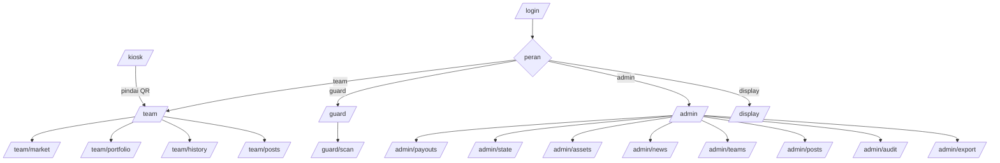

# 07 — UI dan UX

Ada dua jenis perangkat. **Tim tidak membawa ponsel**: mereka hanya memegang kartu QR dan berdagang di **laptop trading** yang disediakan panitia (kamera untuk memindai kartu, dipakai bergantian). **Penjaga pos dan admin memakai ponsel/laptop sendiri.** Konsekuensinya:

- Layar tim dirancang untuk **laptop** (responsif, tetapi desktop-first), dengan teks besar karena sering ada antrean di belakang. Sesi tim pendek: masuk, berdagang, selesai.
- Layar penjaga tetap **mobile-first**: berdiri, di bawah matahari, satu tangan, tombol besar.
- Berita dan perubahan harga harus terbaca sekilas.

> **Acuan layout: situs peserta IT FEST 2026** (`itfest2026.istts.ac.id`, diperiksa langsung 16 Nov 2026: Dashboard, Post List, Market, Portofolio, History). Yang ditiru adalah **struktur dan pola halaman** (§0). Logo, maskot, nama, dan teks milik IT FEST **tidak** dipakai; Classmeet Market memakai identitas sendiri. Warna, tipografi, dan rupa komponen ada di [`DESIGN.md`](DESIGN.md) (mode light, aksen dari maskot, tanpa latar hitam); §0.4 hanya mencatat pengamatan terhadap IT FEST. Dokumen ini mengatur **struktur, alur, dan perilaku**.

## 0. Kerangka layout bersama (acuan IT FEST)

Semua peran memakai satu kerangka yang sama, supaya satu komponen dipakai di mana-mana.

### 0.1 Cangkang aplikasi (`AppShell`)

```
MOBILE / PENJAGA                         LAPTOP TIM (≥ 1024 px, tanpa bilah atas)
┌──────────────────────────┐             ┌──────────┬─────────────────────────┐
│ [☰]  ◉ CLASSMEET MARKET  │ ← bilah     │ ◉ LOGO   │ EYEBROW                 │
├──────────────────────────┤   atas      │          │ Judul Halaman    [chip] │
│ EYEBROW                  │ ← tetap     │ ▸ Beranda│ ┌─────────────────────┐ │
│ Judul Halaman            │             │ ▸ Pos    │ │ kartu               │ │
│ Subjudul redup    [chip] │             │ ▸ Pasar  │ └─────────────────────┘ │
│ ┌──────────────────────┐ │             │ ▸ Portofolio                      │
│ │ kartu                │ │             │ ▸ Riwayat│                         │
│ └──────────────────────┘ │             │ ┌──────┐ │                         │
└──────────────────────────┘             │ │Tim ▢ │ │ ← kartu akun            │
                                         │ │[Selesai]│  (nama + tombol Selesai)│
                                         │ └──────┘ │                         │
                                         └──────────┴─────────────────────────┘
Admin (laptop): kerangka yang sama dengan tim; Keluar dan status koneksi
("Terhubung") ada di kartu akun, tanpa bilah atas.
```

- **Penjaga (ponsel) memakai bilah atas tetap:** tombol menu (☰) di kiri, logo + nama acara. **Layar tim dan admin (laptop) tidak punya bilah atas** (diputuskan 16 Nov): semua kontrol ada di sidebar. Tombol **Selesai** (tim) atau **Keluar** (admin, bersama status koneksi "Terhubung") ada di kartu akun di dasar sidebar (§2.1).
- **Navigasi = laci kiri** (*off-canvas drawer*) di layar sempit: logo, daftar menu dengan ikon (item aktif diberi sorotan dan penanda oranye di tepi kiri), lalu **kartu akun di dasar** (inisial, nama tim, peran, dan **tombol Selesai selebar kartu** di bawah identitas). Di layar ≥ 1024 px (laptop trading, admin), laci menjadi **sidebar tetap**. IT FEST hanya punya laci; sidebar tetap adalah penyesuaian karena laptop punya ruang.
- **Isi satu kolom**, padding samping 18 px (mobile), kartu berurutan ke bawah. Di laptop, isi dibatasi lebar maksimum dan kartu boleh dua kolom.
- Menu tim: **Beranda, Daftar Pos, Pasar, Portofolio, Riwayat**. Menu penjaga: **Pindai** (satu-satunya). Menu admin: lihat §2.3. IT FEST juga punya "Submission" dan "Notification Settings"; keduanya tidak dibuat (tidak ada padanannya di Classmeet).

### 0.2 Pola kepala halaman (`PageHeader`)

Setiap halaman dibuka dengan tiga baris yang sama:

1. **Eyebrow**: huruf kapital kecil berwarna aksen (mis. `LANTAI PERDAGANGAN`, `AKTIVITAS`, `STASIUN POS`).
2. **Judul** besar (± 29 px).
3. **Subjudul** satu kalimat redup. Di sisi kanan boleh ada **chip**: penghitung (mis. "3 Tersedia" / "9 Tidak tersedia"), atau tombol filter.

### 0.3 Pola komponen berulang

| Pola | Bentuk | Dipakai di |
|------|--------|-----------|
| **Kartu panel** | Sudut membulat besar, latar putih, garis tepi tipis dan bayangan biru halus, eyebrow + judul kartu di dalamnya | Semua halaman |
| **Kartu hero** | Kartu bergradasi biru royal, angka sangat besar, dua angka kecil di bawahnya, tombol mata di kanan atas (tanpa tombol lain) | Beranda tim |
| **Ubin inisial** | Kotak membulat berisi 1–2 huruf nama aset, di atas kartu pasar atau di kiri baris | Pasar, Portofolio, Riwayat |
| **Baris daftar** | Ubin kiri, dua baris teks (judul tebal + keterangan redup), nilai/status di kanan, tanda panah › bila bisa diketuk | Pengumuman, Riwayat, Daftar Pos, hadiah |
| **Pil status** | Kapsul kecil dengan titik berwarna + teks (`● Tersedia`, `● Tidak tersedia`) | Pos |
| **Pengelompokan tanggal** | Label tanggal kecil di atas sekelompok baris | Riwayat |
| **Keadaan kosong** | Ilustrasi + judul "Belum ada data" + satu kalimat | Portofolio, Riwayat |
| **Tombol utama** | Lebar penuh, warna aksen, ikon + teks | Beli, Kirim |

### 0.4 Pengamatan visual IT FEST (hanya catatan)

IT FEST memakai latar biru royal terang, aksen lime, dan Space Grotesk. **Classmeet memakai mode light (diputuskan 17 Nov; sebelumnya biru gelap): halaman biru sangat pucat, kartu putih, sidebar putih, tombol utama biru royal, aksen oranye, sian, dan kuning dari maskot (oranye hanya aksen), dengan Sora + Plus Jakarta Sans**; detail di [`DESIGN.md`](DESIGN.md). Yang ditiru dari IT FEST adalah struktur halaman di §0.1–§0.3 dan biru royal pada tombol utama. Tidak ada latar hitam.

### 0.5 Yang sengaja TIDAK ditiru dari IT FEST

- **Tombol "Show QR Code" di layar.** Di Classmeet isi QR adalah akun + kata sandi tim. Menampilkannya di layar laptop berarti menyebarkan kredensial ke siapa pun yang berdiri di belakang. QR hanya ada di kartu fisik.
- **Warna transaksi.** Riwayat IT FEST memberi tanda `+` merah untuk satu jenis transaksi dan `-` cyan untuk yang lain, sehingga arah uang membingungkan. Di sini: `+` untuk uang masuk (jual, hadiah), `−` untuk uang keluar (beli), dengan ikon panah dan teks, tidak bergantung warna.
- **Awalan URL `/admin/` untuk halaman peserta.** Rute tetap `/team`, `/guard`, `/admin`, `/display`.
- Halaman pasar IT FEST tidak menampilkan perubahan harga. Di sini kartu aset **wajib** menampilkan perubahan terakhir (▲/▼ + persen).

## 1. Peta halaman



Satu akun hanya melihat bagian peran miliknya. Mengakses halaman peran lain mengarah kembali ke beranda peran sendiri (middleware), dan data tetap dilindungi database. **Tidak ada halaman leaderboard di area tim.** Leaderboard hanya di `/display` (layar ruang publik) dan di panel admin.

## 2. Halaman per peran

### 2.1 Tim

| Halaman | Isi | Aksi utama |
|---------|-----|------------|
| **Masuk laptop** `/kiosk` | Layar tunggu dengan **kamera aktif**: "Scan QR untuk trading". Setelah QR terbaca dan login berhasil, langsung ke `/team/market`. Selalu mulai dari keadaan keluar. Tidak ada kolom nama/kata sandi | Pindai kartu |
| **Beranda** `/team` | Eyebrow `RINGKASAN`, judul sapaan ("Halo, Tim Elang"; tanpa tanggal atau jam). **Kartu hero** dengan **tiga angka saja:** (1) **Total** = saldo + nilai aset (besar), (2) **Saldo saat ini**, (3) **Nilai aset yang dipegang** menurut **harga peringkat** (VWAP 10 menit; bisa sedikit berbeda dari harga terakhir di halaman Pasar, beri label tooltip), sama dengan yang dipakai peringkat; saldo yang tertahan di order antre ikut dihitung di Total dan ditampilkan terpisah di halaman Order. Ikon info di samping label Nilai aset membuka tooltip yang menjelaskan harga peringkat (Figma `Tim — Beranda (tooltip harga peringkat)`; spesifikasi di DESIGN.md). Tombol mata menyembunyikan semua angka (berguna saat ada antrean di belakang). **Tidak ada tombol Ke Pasar**; pindah halaman lewat sidebar. **Kartu Berita** (§3.0) ada **di bawah kartu hero**, selebar penuh | Sembunyikan angka, baca berita, Selesai (di sidebar) |
| **Pasar** `/team/market` | **Halaman order book** (bukan halaman terpisah; menggantikan kisi kartu aset dan dialog Beli, Figma `Tim — Pasar (order book)`). Eyebrow `LANTAI PERDAGANGAN`, judul **Pasar Langsung**, satu baris **Berita terbaru** (tanpa hitung mundur). Di bawahnya tiga kolom, 272 / 500 / 312 px: **(1) Daftar aset** dengan pencarian, 8 baris (ubin, nama, harga terakhir, chip perubahan), baris terpilih disorot; **(2) Aset terpilih**: kartu detail (nama, harga terakhir besar, chip perubahan nominal + persen, dan sepuluh statistik Open, High, Low, Prev, Avg, ARA, ARB, Lot, Val, Freq) dan kartu **Order book** (5 level bid kiri, 5 level offer kanan, kolom Freq/Lot/Harga, intensitas warna sel mengikuti jumlah lot, garis biru pada order milik tim, ringkasan total bid dan offer lot); **(3) Form order**: tab **Beli / Jual**, jenis **Limit / Market**, *Trading Balance*, **Harga** dengan tombol −/+ (langkah satu fraksi), **Jumlah lot** dengan −/+, ringkasan Jumlah, Biaya 0,25 % dan Total dikunci, tombol *Pasang order beli/jual*, lalu kartu kecil **Order terbuka** dengan tombol Batalkan. Tombol utama royal blue. Klik baris di daftar atau harga di order book mengisi kolom Harga. Saldo yang tampil di form adalah saldo **tersedia** (di luar yang terkunci) | Pasang order, Batalkan |
| **Order** `/team/orders` | Halaman baru (menu sidebar *Order* dengan lencana jumlah order antre). Tiga angka: order antre, saldo terkunci, aset terkunci. Tabel **Order antre** (aset, sisi, jenis, harga, lot, terisi, dikunci, waktu, tombol Batalkan) dan tabel **Riwayat order hari ini** (status terisi / sebagian / dibatalkan oleh tim) | Batalkan |
| **Portofolio** `/team/portfolio` | Eyebrow `KEUANGANKU`, judul Portofolio. Kartu berisi **Total nilai portofolio**, lalu baris per aset (ubin inisial, nama, "3 × Rp 800.000", nilai sekarang, untung/rugi), ketuk untuk membuka Pasar pada aset itu (menjual lewat form order). Kosong: ilustrasi + "Kamu belum punya aset" | Jual |
| **Riwayat** `/team/history` | Eyebrow `AKTIVITAS`, judul Riwayat Transaksi. Satu kartu "Aktivitas terbaru", baris **dikelompokkan per tanggal**: ubin inisial + lencana panah, nama aset, "2 × Rp 800.000 · 14:07", nominal di kanan (`+` masuk, `−` keluar), ketuk untuk rincian. Hadiah pos tampil sebagai baris dengan ubin pos | — |
| **Daftar pos** `/team/posts` | Eyebrow `STASIUN AKTIVITAS`, judul Daftar Pos, subjudul "Lihat lokasi tiap pos dan apakah sedang tersedia". Di kanan kepala: chip **"3 Tersedia"** (hijau) dan **"9 Tidak tersedia"** (merah) + tombol filter. Satu kartu "Ketersediaan saat ini" dengan lencana jumlah pos (12); baris: **ubin nomor (01–12)**, nama game, ikon pin + lokasi, **pil status** di kanan. Data dari `get_post_list()`; tidak menampilkan rentang hadiah. Berubah lewat Realtime `posts` (cadangan: muat ulang tiap 15 detik) | Filter |

**Tombol Selesai** (keluar) ada di **kartu akun di dasar sidebar** semua halaman tim, di bawah nama tim; tidak ada bilah atas. Hitung mundur sesi **tidak tampil** selama sesi berjalan normal; pada 30 detik terakhir muncul **banner kuning di paling atas area isi** ("Sesi segera berakhir. Sentuh layar untuk melanjutkan." + pil hitung mundur "Keluar dalam 0:30", berkedip; digambar di Figma sebagai layar *Tim — Sesi hampir habis*). Sentuhan apa pun menutup banner dan mengatur ulang hitungan. Setiap ketukan atau gerakan mengatur ulang hitungan 5 menit. Setelah keluar, layar kembali ke `/kiosk` untuk tim berikutnya.

Tim **tidak** melihat peringkat. Kartu hero di Beranda hanya memuat tiga angka milik sendiri; daftar berita di bawahnya bukan angka dan tidak melanggar aturan itu. Status hadiah ada di Riwayat. "Nilai aset" di Beranda adalah **harga beli** (diputuskan 16 Nov); halaman Portofolio tetap menampilkan nilai pasar sekarang dan untung/rugi per aset.

### 2.2 Penjaga pos

| Halaman | Isi | Aksi utama |
|---------|-----|------------|
| **Pindai** `/guard/scan` | Kepala halaman (eyebrow `POS 3`, judul Pindai Hadiah), kartu pindai (kamera), **toggle buka/tutup pos** (hijau/merah, tanpa teks), dan **form nominal yang muncul di halaman yang sama** sebagai lembar dari bawah setelah pindai (bukan halaman baru). Form memuat nama tim, **saldo tim saat itu**, kolom nominal, Kirim, dan Batal. Tidak ada kode cadangan, daftar hadiah, indikator antrean, tombol nominal, maupun catatan | Pindai, kirim hadiah, buka/tutup pos |

Toggle pos meminta konfirmasi satu ketukan ("Tutup pos sementara?") agar tidak tertekan tak sengaja. Pos yang ditutup tidak bisa memberi hadiah baru (`post_closed`); hadiah yang sudah terkirim tidak terpengaruh. Pos baru selalu mulai **Tidak tersedia**; penjaga membukanya saat siap. Tombol tidak berfungsi setelah game selesai.

Penjaga **melihat saldo tim hanya untuk tim yang kartunya sedang dipindai**, selama form terbuka (diputuskan 16 Nov; sebelumnya penjaga tidak boleh melihat saldo). Penjaga tetap tidak punya daftar tim, tidak melihat saldo tim lain, dan tidak melihat peringkat; satu-satunya jalan memilih tim adalah memindai QR. Konsekuensinya: siapa pun yang memegang akun penjaga dan satu kartu QR bisa membaca saldo tim itu (lihat [06](06-security.md)). Menu penjaga hanya **Pindai**; halaman riwayat penjaga tidak dibuat.

### 2.3 Admin

| Halaman | Isi | Aksi utama |
|---------|-----|------------|
| **Hadiah** `/admin/payouts` | Daftar hadiah terbaru (tim, pos, penjaga, nominal, waktu), total per pos dan per tim, penanda hadiah yang jauh di atas rata-rata pos itu. **Hanya tampilan; tidak ada persetujuan** | Pintasan ke koreksi saldo |
| **Status** `/admin/state` | Status game, kumpulan berita (siap / boleh terbit / terpakai + peringatan), kontrol leaderboard | **Buka pasar**, **Tutup pasar**, akhiri game, tampil/sembunyikan, bekukan |
| **Aset** `/admin/assets` | Tabel aset (8 teratas dari 25) dengan pencarian dan filter sektor. Kolom: kode, nama, sektor, harga, rentang harga (30%–160% harga), stok, status aktif. Harga berubah **hanya lewat berita yang dipilih sistem**; setelah game dibuka kolom harga, rentang, dan status tidak bisa diubah siapa pun | Sebelum dibuka: ubah harga/rentang, tambah aset. Sesudah dibuka: hanya ubah **stok** |
| **Berita** `/admin/news` | Sebelum game dibuka: daftar kumpulan berita dan tabel efek. Sesudah dibuka: hanya kartu jumlah (§3.8), tanpa isi, urutan, atau hitung mundur | Sebelum dibuka: tandai siap / keluarkan. Sesudah: tidak ada |
| **Tim** `/admin/teams` | Peringkat langsung semua tim. Kolom: peringkat (1 emas, 2 biru muda, 3 oranye, 4+ abu-abu), tim, saldo, nilai aset (harga terakhir), total | Koreksi saldo (dialog: saldo sekarang, selisih, alasan wajib, saldo sesudah), ganti kartu QR (rotasi lewat skrip lokal) |
| **Pos** `/admin/posts` | Pola baris Daftar Pos (ubin nomor, nama, lokasi, pil status) ditambah penjaga dan total hadiah; chip ringkasan "N Tersedia / N Tidak tersedia" di kepala halaman | Buka/tutup pos |
| **Audit** `/admin/audit` | Log perubahan (100 terakhir): waktu, pil aksi (payout_awarded, adjust_cash, set_price, set_state, set_post_open, rotate_team_qr), pelaku, ringkasan. Chip filter: Semua, Hadiah, Koreksi saldo, Harga, Status game, Pos. Hanya baca | — |
| **Ekspor** `/admin/export` | Kartu **Hasil akhir** (tombol utama aktif setelah game selesai dan snapshot final tersimpan) dan kartu **Semua tabel** (jumlah baris + Unduh CSV per tabel). Banner kuning: berkas memuat saldo dan transaksi, simpan di dua tempat | Unduh CSV |

Layout admin: **sidebar tetap** (§0.1) berisi menu di atas; tiap halaman memakai kepala halaman §0.2 dan kartu panel. Tabel besar (aset, tim, audit) ditaruh di dalam kartu panel dan di layar sempit berubah menjadi baris daftar (tanpa gulir horizontal, seperti Riwayat IT FEST). Admin bekerja dari laptop, jadi desktop-first.

### 2.4 Layar ruang publik (`display`)

> **Tambahan 17 Nov:** akun `display` juga mendapat layar **Display pasar** (indeks gabungan IKC, indeks sektor, terbaik/terlemah, berita, transaksi terakhir; Figma `Layar publik — Display pasar`), bergilir dengan layar 5 tim teratas. Keduanya hanya baca. Tidak memuat saldo tim.

Satu halaman penuh layar, tanpa interaksi, **tanpa bilah atas dan laci**. Peringkat memakai pola baris daftar yang diperbesar. **Badge peringkat 1–5 adalah kolom tersendiri yang tetap** (elemen terpisah dari kartu), dan **kartu tim di sebelah kanannya adalah daftar yang bergeser dengan animasi** saat urutan berubah; badge tidak ikut bergerak, jadi warnanya mengikuti posisi, bukan tim. Isi: nama acara dan **5 tim teratas** (kartu, §3.6). Tidak ada ticker berita, lencana pembekuan, maupun status pasar. Dimuat ulang tiap ±5 detik lewat `get_leaderboard()`. Saat leaderboard dibekukan, layar menampilkan snapshot beku tanpa penanda apa pun; saat disembunyikan (`leaderboard_hidden`), tampilkan layar tunggu bertema.

Catatan: `get_leaderboard()` mengembalikan juga saldo dan nilai aset tiap tim. Layar kini menampilkan nama, total, saldo, dan nilai aset; karena akun `display` bisa dibuka di jaringan, **anggap data itu bisa dilihat siapa pun yang memegang perangkatnya.** Karena itu akun `display` dipegang panitia.

## 3. Sketsa tata letak layar utama

### 3.0 Beranda (tim)

```
┌──────────────────────────────────────┐
┌─────────┬────────────────────────────┐
│ ◉ LOGO  │ RINGKASAN                  │
│ Beranda │ Halo, Tim Elang            │
│ Pos     │ Cek saldo dan baca berita… │
│ Pasar   │ ╔════════════════════════╗ │
│ Portofolio║ ◉ TOTAL            [👁] ║ │  ← kartu hero bergradasi biru
│ Riwayat │ ║ Rp 5.525.000           ║ │
│         │ ║ Saldo      Nilai aset  ║ │
│         │ ║ Rp 1.200.000 Rp 4.325.000║ │
│ ┌─────┐ │ ╚════════════════════════╝ │
│ │TE Tim Elang│ ┌────────────────────┐ │
│ │[Selesai]│  │ TETAP TERHUBUNG     │ │  ← kartu Berita DI BAWAH hero
│ └─────┘ │ │ Berita              │ │
│         │ │ [▲] Pasokan pangan… ›│ │  ← ikon, judul, 2 baris isi, waktu
│         │ │ [★] Layanan hiburan…›│ │
│         │ └────────────────────┘ │
└─────────┴────────────────────────────┘
```

Daftar berita memuat semua berita yang sudah tayang (terbaru di atas); efek tidak ditampilkan. Berita terbaru diberi lencana "Baru".

### 3.1 Pasar (tim, laptop trading)

```
┌──────────────────────────────────────────────┐
│ (sidebar kiri: menu + kartu akun [Selesai])  │  ← tanpa bilah atas
│ LANTAI PERDAGANGAN                           │
│ Pasar Langsung                               │  ← tanpa pil status pasar dan saldo
│ Temukan aset dan bangun portofolio.          │     (tanpa hitung mundur; tim tidak
│ [📰 Pasokan pangan terganggu ▾]              │      boleh tahu kapan harga berubah)
│ [🔍 Cari aset………………]            [⚙ filter]  │  ← berita terbaru, ketuk = isi penuh
│ ┌──────────────┐ ┌──────────────┐            │     (efek TIDAK ditampilkan)
│ │ [AP] Apple ▲+3,0%│ │ [NB] Nusabyte ▼−2,0%│  │  ← ubin + nama + chip perubahan
│ │ Rp 800.000   │ │ Rp 650.000   │            │  ← panah + teks, bukan hanya warna
│ │ ● stok 10 · punya 3 │ ● stok 4 · punya 0│ │  ← titik merah bila stok rendah
│ │ [  Beli  ]   │ │ [  Beli  ]   │            │  ← tidak pernah nonaktif
│ └──────────────┘ └──────────────┘            │
│ …                                            │
└──────────────────────────────────────────────┘
```

Kisi dua kolom di layar sempit, empat kolom di laptop lebar.

**Tombol Place Order tidak pernah dinonaktifkan**, apa pun saldo, lot, atau harga yang diisi. Semua penolakan terjadi **saat tim menekan Place Order** dan alasannya ditampilkan di dalam form (§3.2). Beli dan jual keduanya dilakukan di halaman Pasar; Portofolio hanya menampilkan kepemilikan.

### 3.2 Form order (di halaman Pasar)

Kolom ketiga halaman Pasar (`/team/market`; Figma `Tim — Pasar (order book)`). Tidak ada dialog konfirmasi terpisah: pencocokan terjadi seketika dan hasilnya (terisi / sebagian / antre) tampil di ringkasan order terbuka di bawah form.

- Tab **Beli / Jual**, jenis **Limit / Market**. Limit: **Harga** dengan tombol −/+ yang melompat satu fraksi harga (Rp 500 / 1.000 / 2.500 menurut rentang) dan **Lot** dengan −/+. Market: hanya Lot; harga diganti keterangan "sapu hingga 5 level".
- Form memakai **harga terakhir** sebagai isian awal. Bila harga acuan berubah (berita) saat form terbuka, isian **tidak** diganti diam-diam; batas ARA/ARB dan level order book diperbarui dan tim menekan Place Order lagi bila tetap mau.
- *Trading Balance* menampilkan saldo bebas milik tim; saldo yang terkunci tampil di halaman Order. Input tidak dibatasi saldo atau lot yang dimiliki (supaya angka tidak bocor lewat nilai maksimum); database yang memeriksa.
- Setiap pengiriman membawa `request_id` baru; tombol dinonaktifkan sementara selama proses. Kirim ulang karena jaringan putus memakai `request_id` yang sama sehingga tidak menggandakan order.
- Bila database menolak, pesan Bahasa Indonesia dari tabel error ([04-rpc-contracts](04-rpc-contracts.md#7-error-code)) muncul di atas tombol, form tetap terisi: `insufficient_cash` ("Saldo tidak cukup."), `insufficient_holdings`, `price_out_of_range`, `invalid_tick`, `market_closed`, `asset_not_found`.
- Order market yang tidak terisi penuh (kehabisan lawan atau saldo) menampilkan hasil sebagian: "Terisi 3 dari 6 lot; sisa dibatalkan."

### 3.3 Masuk laptop trading (`/kiosk`)

```
┌──────────────────────────────────────────────┐
│  CLASSMEET MARKET                            │
│   ┌──────────────────┐                       │
│   │ [pratinjau kamera] │  Scan QR untuk trading │
│   └──────────────────┘                       │
└──────────────────────────────────────────────┘
```

- `/kiosk` adalah satu-satunya halaman tim **tanpa** `AppShell` (tanpa laci dan menu): layar penuh, hanya logo, pratinjau kamera, dan status pasar.
- Halaman **selalu** menghapus sesi lama saat dibuka, lalu menyalakan kamera. QR terbaca sekali, login berjalan otomatis, tim langsung masuk ke Pasar. Bila gagal: "Kartu tidak dikenali. Coba lagi atau minta bantuan panitia." Setelah 5 kegagalan beruntun, tahan 10 detik.
- Tidak ada kolom nama, kata sandi, atau PIN. Layar tidak menampilkan nama laptop maupun status pasar.
- Nama laptop (mis. `laptop-3`) tetap diset sekali per perangkat di konfigurasi dan dikirim ke `log_kiosk_event` agar admin bisa menelusuri laptop mana yang dipakai; **tidak ditampilkan di layar**.
- Bila kamera ditolak/tidak ada: "Kamera tidak bisa dipakai. Pindah ke laptop lain atau hubungi panitia." Kamera memerlukan HTTPS (disediakan Cloudflare Tunnel).
- Kartu QR berisi **akun + rahasia** tim: cetak laminasi, jangan tampil di layar. Kehilangan kartu = kehilangan akses; meja bantuan mengganti kartu lewat rotasi ([08-operations](08-operations.md#8-rencana-darurat)).
- Penjaga memindai kartu yang sama untuk hadiah. Tidak ada input kode cadangan di UI; kartu rusak diganti lewat rotasi kartu.

### 3.4 Pindai dan beri hadiah (penjaga)

Dua keadaan pada **satu halaman** (form bukan halaman baru; ia muncul sebagai lembar di atas layar pindai). Saldo tim diambil dari `resolve_team_qr` ([04 §3.2](04-rpc-contracts.md)) dan dibaca **sekali saat QR terbaca**; angkanya tidak diperbarui selama form terbuka dan tidak dipakai untuk membatasi nominal.

```
KEADAAN 1 — SIAP PINDAI
┌────────────────────────────┐
│ Pos 3 · Merakit Buta  [●━] │  ← toggle buka/tutup pos, tanpa teks status
│ ┌────────────────────────┐ │     hijau = tersedia, merah = tutup
│ │      [ KAMERA ]        │ │
│ └────────────────────────┘ │
└────────────────────────────┘

KEADAAN 2 — FORM (setelah QR terbaca, di halaman yang sama)
┌────────────────────────────┐
│ ░░ kamera digelapkan ░░░░░░ │  ← overlay biru, halaman pindai tetap di belakang
│ ┌────────────────────────┐ │
│ │ ── (pegangan) ──        │ │  ← lembar dari bawah
│ │ TIM TERBACA            │ │
│ │ Tim Cakra              │ │
│ │ ┌────────────────────┐ │ │
│ │ │ Saldo tim saat ini │ │ │  ← saldo tim yang baru dipindai
│ │ │ Rp 930.000         │ │ │
│ │ └────────────────────┘ │ │
│ │ Nominal [ 300000     ] │ │
│ │ [ Kirim Rp 300.000 ]   │ │
│ │ [ Batal ]              │ │
│ └────────────────────────┘ │
└────────────────────────────┘
```

**Toggle pos.** Satu saklar tanpa tulisan status. Hijau (geser ke kanan) = pos tersedia, merah (geser ke kiri) = tutup. Karena tidak ada teks, saklar tetap harus bisa dibaca tanpa warna: posisi tombol bulat kiri/kanan berbeda, dan `aria-label` "Pos tersedia" / "Pos tutup" untuk pembaca layar. Perubahan meminta konfirmasi satu ketukan ("Tutup pos sementara?" / "Buka pos?"). Tidak ada kolom ketik kode, daftar hadiah sebelumnya, maupun indikator antrean di halaman ini.

Perilaku wajib:

1. **Form hilang segera saat "Kirim" ditekan** dan layar kembali ke Keadaan 1 dengan kamera aktif, siap memindai tim berikutnya. Tombol menampilkan nominal terformat (mis. "Kirim Rp 300.000") supaya nol berlebih mudah terbaca; tidak ada dialog konfirmasi tambahan dan tidak ada batas nominal (diputuskan).
2. Sebelum form ditutup, hadiah ditulis ke **antrean lokal** (`request_id` dibuat saat form muncul). Pengiriman berjalan di latar belakang, dengan percobaan ulang memakai `request_id` yang sama. Catatan (`p_note`) tidak dikirim dari UI.
3. Hasil diberi tahu lewat **toast**: "Rp 300.000 terkirim ke Tim Cakra" saat database menerima. **Saldo tim sudah bertambah saat toast muncul.**
4. Hadiah yang gagal permanen (mis. pos ditutup, game selesai) memunculkan toast **merah yang tetap tampil** dengan alasan dan tombol "Kirim ulang" sampai ditutup penjaga; tidak boleh hilang diam-diam.
5. Pindai ganda (QR yang sama terbaca dua kali beruntun) diabaikan selama form terbuka. Karena tidak ada penyaring di database, penjaga yang salah menekan dua kali dengan form baru menghasilkan dua hadiah; hanya `request_id` yang sama yang dijaga.
6. Nominal disaring ke bilangan bulat positif. Tidak ada tombol nominal cepat.

### 3.5 Daftar hadiah (admin)

Tidak ada antrean persetujuan. Halaman ini hanya **tampilan** untuk pengawasan sesudah kejadian:

```
┌──────────────────────────────────────────────────────┐
│ HADIAH TERBARU                     [Total per pos ▾]   │
├──────────────────────────────────────────────────────┤
│ 14:05  Tim Cakra ← Pos 3 (Rina)   Rp 300.000          │
│ 14:04  Tim Elang ← Pos 7 (Dimas)  Rp 5.000.000  ⚠    │  ← jauh di atas rata-rata pos
│ …                                    [ Koreksi saldo ] │
└──────────────────────────────────────────────────────┘
```

- Tampilkan 100 hadiah terbaru, total per pos dan per tim; tandai (⚠) hadiah yang lebih dari 3× rata-rata hadiah pos itu. Ini hanya penanda visual, bukan penahan.
- "Koreksi saldo" membuka `admin_adjust_cash` untuk tim itu (alasan wajib). Itu satu-satunya cara membatalkan hadiah yang salah.
- Daftar disegarkan lewat Realtime pada tabel `payouts` (cadangan polling 10 detik).
- Menutup game tidak lagi tertahan oleh hadiah.

### 3.6 Layar publik

Lima tim dengan **total tertinggi**. **Lima kartu tersusun ke bawah**, peringkat 1 di atas. **Badge peringkat (1–5) adalah kolom terpisah di kiri**, bukan bagian dari kartu, supaya kartu tim bisa **bergeser dengan animasi** saat urutan berubah sementara badge tetap di tempatnya. Di dalam tiap kartu, **nama tim di kiri**, dan **di sebelah kanannya** berjajar menyamping **Total, Saldo, dan Nilai aset**, masing-masing dengan angka tepat di bawah labelnya. Antar kolom diberi **jarak lebar** (space) sebagai pemisah; tanpa garis. Warna badge: 1 kuning, 2 biru muda, 3 oranye, **4 dan 5 abu-abu**.

```
┌────────────────────────────────────────────────────────────────────────┐
│  CLASSMEET MARKET                                                      │
├────────────────────────────────────────────────────────────────────────┤
│ [1]  ┌────────────────────────────────────────────────────────────┐ │
│      │ Tim Elang        Total            Saldo         Nilai aset  │ │
│      │                  4.820.000        1.200.000     3.620.000   │ │
│      └────────────────────────────────────────────────────────────┘ │
│ [2]  ┌────────────────────────────────────────────────────────────┐ │
│      │ Tim Cakra        Total            Saldo         Nilai aset  │ │
│      │                  4.115.000        1.000.000     3.115.000   │ │
│      └────────────────────────────────────────────────────────────┘ │
│  …   sampai peringkat 5; kolom badge tetap, kartu yang bergeser      │
└────────────────────────────────────────────────────────────────────────┘
```

- **Total** = saldo saat ini + nilai aset. **Nilai aset** = Σ unit × **harga peringkat** (VWAP 10 menit) tiap aset (termasuk lot yang terkunci di order jual). Saldo yang terkunci di order beli ikut menjadi bagian saldo.
- Dasar angka: `get_leaderboard()` memakai harga peringkat (`rank_price`) untuk `holdings_value` dan `net_worth` (`cash` = saldo bebas + terkunci) ([03 §4](03-database.md#4-kalkulasi-net-worth)); peringkat dan pemenang akhir juga diurut menurut total ini. Layar mengambil seluruh hasil dan menampilkan 5 baris pertama.
- Font sangat besar, kontras tinggi, terbaca dari jauh. Tanpa elemen interaktif.

### 3.7 Panel status (admin)

Pusat kendali harian. Hanya memuat hal yang **harus ditekan atau dipantau**; isi kumpulan berita ada di §3.8 (terkunci setelah game dibuka).

```
┌──────────────────────────────────────────────┐
│ STATUS: ● OPEN  (hari 2, 14:05)              │
│ [ TUTUP PASAR ]  [ AKHIRI GAME ]             │  ← butuh konfirmasi; Buka pasar muncul bila paused/setup
│                                              │
│ KUMPULAN BERITA                              │
│  Siap 38 · boleh terbit 31 · terpakai 12     │
│  ⚠ Boleh terbit tinggal 5 (± dua jam)        │  ← kuning bila ≤ 6; merah bila 0 saat pasar buka
│                                              │
│ Leaderboard:  ☑ tampil   [ Bekukan sekarang ]│
└──────────────────────────────────────────────┘
```

Admin membuka pasar tiap pagi (08.00) dan menutupnya tiap malam (19.00) dengan **Buka pasar** / **Tutup pasar**; tidak ada jadwal otomatis, jadi **jangan lupa menutup** ([08-operations](08-operations.md#7-daftar-periksa-waktu)). **Akhiri game** hanya dipakai di akhir hari ketiga, setelah perubahan harga terakhir; bila masih ada berita live, database menolak dan pesan penolakannya tampil sebagai galat (tidak ada baris peringatan terpisah).

- **Kumpulan berita** adalah satu-satunya tempat admin melihat jumlah berita *siap / boleh terbit / terpakai*. Peringatan kuning bila *boleh terbit* ≤ 6 (± dua jam), merah bila 0 saat pasar buka (pasar akan diam).
- **Tidak ada tombol untuk menjalankan, mempercepat, atau menunda siklus berita.** Siklus sepenuhnya milik sistem (`pg_cron` tiap 10 detik). Bila `pg_cron` mati, perbaikannya ada di server ([08-operations](08-operations.md)), bukan di panel.
- Tidak ada hitung mundur berita, jeda siklus, maupun biaya transaksi di panel ini. Admin **tidak boleh tahu kapan harga berubah**; waktu itu hanya diketahui sistem.
- Sejak game dibuka, panel hanya memanggil `get_news_pool_status()` (jumlah saja). Isi dan urutan berita tidak terbaca admin.

### 3.8 Kumpulan berita (admin)

Berita **tidak dipilih dan tidak dijadwalkan admin**. Halaman ini punya dua wajah, tergantung `game_settings.started_at`:

**Sebelum game dibuka (persiapan).** Tampilan daftar: judul, status (draf / siap), jumlah aset terkena, tabel efek lengkap dengan pratinjau "Sesudah" (dihitung di klien dengan rumus yang sama dengan database), dan peringatan batas harga. Admin boleh menulis, menyunting, menandai siap, atau mengeluarkan berita dari kumpulan. Penulisan dan penandaan massal tetap lewat `scripts/import-news.ts` ([08](08-operations.md#2-setup-awal)); database menolak berita yang melanggar aturan efek (4–7 aset, tanpa aset ganda, maksimum ±15 %). Ringkasan di atas daftar: *ditargetkan ±220 siap*, jumlah siap sekarang, dan jumlah aman diterbitkan.

**Setelah game dibuka (terkunci).** Seluruh isi halaman diganti satu kartu informasi:

```
KUMPULAN BERITA TERKUNCI
Game sudah dimulai. Urutan dan waktu berita diatur sistem.
Siap 188 · terpakai 31 · sedang tayang 1
Harga tidak bisa diubah oleh siapa pun sampai game selesai.
```

- Angka dari `get_news_pool_status()` saja. **Tidak ada** daftar berita siap, judul berita berikutnya, tabel efek, ataupun hitung mundur: RLS menyembunyikan `news` dan `news_effects` dari admin sejak game dibuka.
- Berita yang sedang tayang tampil seperti di layar tim (judul dan isi dari `news_feed`), tanpa efek dan tanpa waktu perubahan harga.
- Tidak ada tombol "pilih sebagai berikutnya", "luncurkan", "percepat", atau "batalkan".

## 4. Status antarmuka

| Situasi | Perilaku |
|---------|----------|
| **Memuat** | Kerangka (skeleton) pada daftar, bukan spinner layar penuh |
| **Kosong** | Pesan jelas: "Kamu belum memiliki aset. Buka Pasar untuk mulai." |
| **Sesi hampir habis** | 30 detik terakhir: **banner di atas isi halaman** (tidak ada bilah atas di layar tim) berisi "Sesi segera berakhir. Sentuh layar untuk melanjutkan." dan hitung mundur berkedip |
| **Sesi habis** | Keluar otomatis ke `/kiosk`; form order yang terbuka dibatalkan; order yang sudah antre tetap berjalan, tidak ada transaksi setengah jadi |
| **Pasar tertutup** | Banner di atas; tombol Beli tetap aktif dan penolakan muncul saat Konfirmasi |
| **Pasar dijeda** | Banner "Pasar dijeda panitia", data tetap terlihat |
| **Aksi berjalan** | Tombol dinonaktifkan dan menampilkan "Memproses…" supaya tidak ditekan dua kali |
| **Sukses** | Toast singkat + saldo dan portofolio diperbarui |
| **Gagal** | Pesan Bahasa Indonesia dari tabel error ([04-rpc-contracts](04-rpc-contracts.md#7-error-code)), tombol "Coba lagi" memakai `request_id` yang sama jika penyebabnya jaringan |
| **Offline / koneksi putus** | Banner "Koneksi terputus, mencoba menyambung kembali…". Setelah tersambung, ambil ulang semua data |
| **Harga berubah (efek berita diterapkan)** | Sorot singkat pada angka dengan panah dan teks, bukan hanya warna |
| **Hadiah masuk** | Toast "Hadiah Rp 300.000 dari Pos 3 masuk" di akun tim; saldo dimuat ulang |
| **Berita baru** | Toast dan lencana pada ikon berita |
| **Saldo kurang / lot kurang / harga di luar batas** | Tombol Place Order tetap aktif; penolakan dengan alasan muncul di dalam form saat ditekan |

## 5. Realtime di sisi klien

- Semua peran berlangganan `assets`, `news_feed`, `game_settings` di layout peran. Tabel `news` hanya dibaca admin **sebelum game dibuka** (halaman persiapan); sesudahnya tidak ada polling `news`.
- `game_settings` memberi `state`. **Tidak ada klien yang menerima `effect_at`**, termasuk admin: setelah game dibuka tabel `news` tidak terbaca siapa pun lewat klien, dan hanya `news_feed` (judul, isi, waktu tayang) yang dilanggan. Hitung mundur berita tidak ada di UI mana pun.
- **Admin** juga berlangganan `payouts` (semua). **Penjaga** menerima hadiah posnya. **Tim** menerima hadiah miliknya dan, pada event itu, memuat ulang `get_my_summary()`.
- Saldo tim tidak datang lewat Realtime; ambil `get_my_summary()` saat dibuka, tiap ±10 detik, dan setelah event hadiah/transaksi.
- Layar publik: `get_leaderboard()` tiap ±5 detik (tanpa Realtime).
- Saat tab kembali aktif atau koneksi tersambung ulang, ambil ulang semua data penting. **Jangan menganggap Realtime tidak pernah terlewat.**

## 6. Aksesibilitas dan keterbacaan

- Target sentuh minimal **44 × 44 px**; tombol kirim dan tombol nominal penjaga lebih besar lagi.
- Kontras teks memenuhi WCAG AA, terutama di bawah sinar matahari. Uji dengan kecerahan layar penuh.
- Naik/turun harga dan status hadiah ditandai **ikon/teks** (▲ +3,0 % / ▼ −5,0 %; ✓ terkirim / ⏳ belum terkirim), tidak hanya hijau/merah, agar terbaca oleh buta warna.
- Hormati `prefers-reduced-motion`: animasi sorot harga dimatikan.
- Angka rupiah selalu dengan pemisah ribuan (`Rp 1.250.000`) dan font angka tabular agar sejajar.
- Bahasa antarmuka: Indonesia. Waktu: WIB, format 24 jam.
- Formulir memakai label yang terhubung, urutan fokus logis, dan keyboard numerik untuk input angka (`inputmode="numeric"`).
- Layar tim (laptop): teks dasar ≥ 18 px, jarak antar tombol cukup untuk layar sentuh maupun tetikus.
- Pemindai QR: minta izin kamera dengan penjelasan singkat; tidak ada jalur kode cadangan; kamera yang tidak berfungsi berarti ganti perangkat.

## 7. Komponen bersama

| Komponen | Dipakai di |
|----------|-----------|
| `MoneyText` (format rupiah) | Semua |
| `PriceChange` (panah + persen) | Pasar, portofolio |
| `NewsCountdown` (menuju `effect_at`) | **Hanya halaman berita admin.** Tidak dipakai di sisi tim, penjaga, atau layar publik |
| `NewsCurrentCard` / `NewsUpcomingList` / `NewsPoolStatus` | Admin berita |
| `MarketStatusBanner` | Layout tim, penjaga, admin |
| `AssetCard` (ubin + nama + chip perubahan, harga, stok, Beli) | Pasar, portofolio |
| `TradeDialog` | Pasar, portofolio |
| `QrScanner` + `PostToggle` + `PayoutSheet` (lembar form nominal dengan saldo tim) | Penjaga |
| `PayoutQueue` (lokal, dengan percobaan ulang; tanpa tampilan daftar) | Penjaga |
| `PayoutList` (tampilan saja) | Admin hadiah |
| `AppShell` (laci/sidebar + kartu akun dengan tombol Selesai/Keluar; bilah atas hanya untuk penjaga) | Layout tim, penjaga, admin |
| `PageHeader` (eyebrow, judul, subjudul, chip) | Semua halaman kecuali `/kiosk` dan `/display` |
| `HeroBalanceCard` (tiga angka + tombol mata, tanpa tombol lain) | Beranda tim |
| `ListRow` (ubin, dua baris teks, nilai/status, ›) | Berita, Riwayat, Daftar Pos, hadiah, peringkat |
| `StatusPill` / `StatChip` | Daftar Pos, kepala halaman, admin pos |
| `AssetTile` (ubin inisial) | Pasar, Portofolio, Riwayat |
| `EmptyState` | Portofolio, Riwayat, daftar kosong |
| `KioskScanner` | Halaman `/kiosk` |
| `SessionBanner` (strip kuning di atas isi + hitung mundur) | Layout tim, hanya di 30 detik terakhir |
| `LeaderboardScreen` (kolom `RankBadges` tetap + daftar `TeamRow` beranimasi) | Layar publik, admin |
| `NewsToast` / `NewsList` | Beranda, layout |
| `ConfirmDialog` | Aksi berbahaya admin |
| `DataTable` | Admin, riwayat |
| `RealtimeProvider` | Layout peran |

## 8. Hal yang sengaja tidak dibuat di versi 1

- Grafik harga interaktif lengkap. Cukup sparkline sederhana dari `price_history` jika sempat.
- Mode gelap. Diputuskan 17 Nov: hanya light, tanpa toggle tema.
- Notifikasi push ke perangkat admin. Notifikasi dalam aplikasi (lencana, judul tab, nada) cukup selama admin membuka halaman yang relevan.
- Antrean persetujuan hadiah (ACC) dan batas nominal: dihapus atas keputusan panitia.
