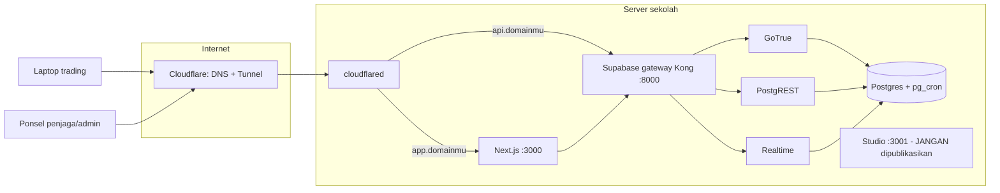

# 11 — Deployment: Docker di server sekolah + Cloudflare Tunnel

Dokumen ini menjelaskan cara menjalankan seluruh sistem di **server milik guru di sekolah**, dengan Supabase self-hosted dan aplikasi Next.js dalam Docker, dan diakses lewat **Cloudflare Tunnel** pada domain milikmu. Tidak ada Vercel dan tidak ada Supabase Cloud.

> **Status verifikasi.** Rancangan SQL sudah diuji di PostgreSQL 16 biasa ([10-verification-report](10-verification-report.md)). **Semua yang ada di dokumen ini belum dicoba**: konfigurasi di bawah ditulis dari pengetahuan tentang paket Docker resmi Supabase dan Cloudflare Tunnel, tanpa menjalankannya. Nama variabel, nama kontainer, dan perilaku image bisa berbeda di versi yang kamu unduh. Perlakukan ini sebagai daftar apa yang harus diperiksa, bukan resep yang pasti jalan. Ikuti dokumentasi resmi untuk versi yang kamu pakai bila ada beda.

## 1. Gambaran

Dua nama domain: `app.domainmu` untuk Next.js, `api.domainmu` untuk gateway Supabase (REST, Auth, Realtime). Klien (browser) memanggil `api.domainmu` langsung, jadi `NEXT_PUBLIC_SUPABASE_URL` mengarah ke sana. **Studio tidak pernah dipublikasikan.**

## 2. Prasyarat

| Hal | Catatan |
|-----|---------|
| Server | Linux dengan Docker + Docker Compose. Minimal 4 GB RAM dan beberapa GB disk bebas (Supabase menjalankan belasan kontainer) |
| Listrik dan tidur | Server **tidak boleh tidur/hibernasi**; nonaktifkan suspend, pastikan tidak mati saat sekolah menutup listrik. UPS bila ada |
| Jaringan | Server di kabel LAN, keluar ke internet. **Tidak perlu membuka port masuk** (tunnel menyambung keluar). Siapkan hotspot cadangan |
| Domain | Domainmu di Cloudflare, dengan akses membuat tunnel |
| Waktu | Sinkron NTP di server (siklus berita bergantung pada jam database; zona WIB hanya tampilan) |
| Akses | Siapa yang memegang server fisik dan akun SSH-nya jelas. Aktifkan 2FA pada akun Cloudflare dan GitHub |

## 3. Menyiapkan Supabase self-hosted

1. Ambil paket Docker resmi Supabase (folder `docker` di repositori Supabase) ke server, misalnya `/opt/classmeet/supabase`. Salin `.env.example` menjadi `.env`.
2. **Ganti semua rahasia contoh.** Kunci dan kata sandi bawaan bersifat publik. Minimal buat ulang: `POSTGRES_PASSWORD`, `JWT_SECRET`, `ANON_KEY`, `SERVICE_ROLE_KEY` (dua kunci ini adalah JWT yang **ditandatangani dengan `JWT_SECRET`** baru, bukan nilai acak), `DASHBOARD_USERNAME`/`DASHBOARD_PASSWORD`, `SECRET_KEY_BASE`, dan kunci enkripsi lain yang ada di berkas contoh. Dokumentasi Supabase menjelaskan cara membuat JWT-nya. Simpan di pengelola kata sandi, bukan di repositori.
3. Atur URL: `SITE_URL=https://app.domainmu`, `API_EXTERNAL_URL=https://api.domainmu`, `SUPABASE_PUBLIC_URL=https://api.domainmu`.
4. Auth (GoTrue): matikan pendaftaran mandiri (`DISABLE_SIGNUP=true`), biarkan akun dibuat hanya lewat skrip dengan service role; atur kedaluwarsa JWT pendek (`JWT_EXPIRY`, mis. 900 detik) sebagai cadangan di luar pengatur waktu 5 menit di aplikasi. Karena akun tim dibuat dengan alamat email palsu (mis. `elang@classmeet.local`), aktifkan konfirmasi otomatis (`ENABLE_EMAIL_AUTOCONFIRM=true`) dan **jangan** aktifkan pengiriman email.
5. Jalankan `docker compose pull && docker compose up -d`, lalu `docker compose ps` dan pastikan semua sehat.
6. **Jangan mengekspos port Studio dan port Postgres ke luar mesin.** Ubah pemetaan port di berkas compose agar terikat ke `127.0.0.1`, atau hapus pemetaannya bila tak dibutuhkan. Postgres hanya perlu dijangkau dari dalam jaringan Docker dan, untuk migrasi, lewat `docker exec`.

### 3.1 Migrasi skema

Jalankan blok SQL dari [03-database](03-database.md) dan [04-rpc-contracts](04-rpc-contracts.md) **secara berurutan** ke database (`docker exec -i <kontainer-db> psql -U postgres -d postgres < berkas.sql`), memakai berkas migrasi yang dibangun dari dokumen (skrip `tests/build2.py` membuat gabungan dengan stub uji; **jangan** memuat bagian stub itu ke Supabase asli karena Supabase sudah punya skema `auth` dan peran `anon`/`authenticated`). Setelah itu jalankan ulang uji RLS dan hak akses ([06-security](06-security.md)) terhadap database ini; ini adalah verifikasi pertama pada skema Supabase sungguhan.

### 3.2 pg_cron (verifikasi wajib di H-7)

Siklus berita **tidak jalan tanpa penjadwal**. Pada image Postgres Supabase, ekstensi `pg_cron` biasanya tersedia, tetapi ini belum dicoba di sini:

1. `select * from pg_available_extensions where name = 'pg_cron';` harus mengembalikan baris.
2. `create extension if not exists pg_cron;` lalu jadwalkan sesuai blok `[lewati-uji]` di [03-database](03-database.md) (memanggil `process_news_cycle()` dan `process_market_cycle()` tiap 10 detik; butuh `pg_cron` 1.5+).
3. Setelah 3 menit: `select * from cron.job_run_details order by start_time desc limit 5;` harus menampilkan eksekusi sukses.
4. Bila `pg_cron` tidak bisa dipakai: **cadangan** berupa pengulang pada host yang memanggil tiap 10 detik (`while true; do docker exec <kontainer-db> psql -U postgres -c "select public.process_news_cycle(); select public.process_market_cycle()"; sleep 10; done`, dijalankan sebagai layanan systemd) atau kontainer kecil yang memanggilnya tiap 10 detik. Jangan pakai cron per menit: undian waktu berita mengandaikan ketelitian 10 detik, dan per menit membuat perubahan harga bisa terlambat hingga 16 menit. Fungsinya aman dipanggil berulang dan serentak (diuji).

## 4. Aplikasi Next.js

- `output: 'standalone'` pada `next.config`, `Dockerfile` bertahap (build → runtime), jalan sebagai pengguna non-root, port 3000.
- Variabel lingkungan runtime: `NEXT_PUBLIC_SUPABASE_URL=https://api.domainmu`, `NEXT_PUBLIC_SUPABASE_ANON_KEY=<anon baru>`. **`SUPABASE_SERVICE_ROLE_KEY` tidak boleh ada di kontainer aplikasi**: ia hanya dipakai skrip lokal (`create-accounts`, `rotate-team-qr`, `print-qr`) yang dijalankan dari laptop admin atau lewat `docker run` sekali pakai, tidak pernah pada jalur permintaan peserta. Variabel `NEXT_PUBLIC_*` ditanam saat build, jadi bangun ulang image bila domain berubah.
- Tambahkan layanan `app` ke berkas compose (atau berkas compose terpisah pada jaringan yang sama) dengan `restart: unless-stopped` dan `healthcheck` ke `/api/health`.

## 5. Cloudflare Tunnel

1. Buat tunnel (dashboard Cloudflare Zero Trust, atau `cloudflared tunnel create`), pasang `cloudflared` sebagai layanan (kontainer atau systemd) dengan `restart` otomatis.
2. Rute publik:
   - `app.domainmu` → `http://app:3000` (atau alamat kontainer aplikasi)
   - `api.domainmu` → `http://kong:8000`
3. **Tidak ada rute untuk Studio.** Bila perlu membuka Studio, lakukan lewat terowongan SSH dari laptop teknis.
4. WebSocket (Realtime) harus lolos di `api.domainmu`; Cloudflare mendukungnya secara bawaan, tetapi **uji** (bagian 7).
5. Jangan menaruh halaman admin di belakang Cloudflare Access kecuali kamu sudah menguji bahwa login staf dan Realtime tetap berfungsi; bila dipakai, lindungi hanya `/admin`.
6. Kamera di browser memerlukan **HTTPS**; Cloudflare menyediakannya pada domain publik. Mengakses lewat IP LAN tanpa HTTPS akan membuat kamera ditolak.

## 6. Ketahanan dan cadangan

| Hal | Tindakan |
|-----|----------|
| Restart otomatis | `restart: unless-stopped` pada semua layanan; uji dengan `reboot` server |
| Data | Volume Docker bernama untuk data Postgres; **jangan** `docker compose down -v` |
| Cadangan terjadwal | Cron host tiap 30 menit saat acara: `docker exec <kontainer-db> pg_dump -U postgres -Fc postgres > /opt/classmeet/backup/db-$(date +%F-%H%M).dump`; salin keluar server (laptop admin / penyimpanan awan pribadi). Simpan juga `.env` terenkripsi |
| Latihan pemulihan | Pulihkan dump ke instans staging dan jalankan uji dasar. **Cadangan yang belum pernah dipulihkan belum bisa dipercaya** |
| Disk | Pantau ruang kosong; hapus dump lama setelah disalin |
| Jam | `timedatectl` menunjukkan sinkron NTP |
| Internet | Hotspot cadangan sudah diuji dengan `cloudflared`; tahu cara menyambungkan server ke jaringan itu |

## 7. Daftar uji asap (smoke test), sebelum gladi

Jalankan berurutan di stack produksi (atau salinannya) lewat domain publik:

- [ ] `https://app.domainmu/api/health` hijau dari ponsel **di luar jaringan sekolah** (data seluler).
- [ ] Login admin, penjaga, dan display berhasil; halaman peran lain mengarahkan kembali.
- [ ] **Realtime lewat tunnel:** tunggu berita staging berlaku (jeda dipendekkan, sebelum game dibuka); harga di halaman tim berubah tanpa muat ulang. Panel admin tidak punya cara mengubah harga.
- [ ] **Kamera di laptop trading** terbuka pada `https://app.domainmu/kiosk`; satu kartu QR terbaca dan login berhasil.
- [ ] Keluar otomatis 5 menit; `/kiosk` menghapus sesi lama; kata sandi/`qr_token` tidak muncul di log aplikasi maupun Network tab.
- [ ] `scripts/rotate-team-qr.ts` pada satu tim uji: kartu lama berhenti berfungsi, kartu baru bisa masuk.
- [ ] `cron.job_run_details` menunjukkan siklus berjalan tiap 10 detik; berita terbit sendiri dari kumpulan uji (`news_delay_min_minutes` dan `news_delay_max_minutes` dipendekkan di staging, sebelum game dibuka).
- [ ] `pg_dump` berhasil dan hasilnya dipulihkan di tempat lain.
- [ ] Cabut kabel jaringan server 2 menit, lalu pasang: tunnel tersambung sendiri, harga dan sesi pulih, tidak ada transaksi ganda.
- [ ] Restart server penuh: semua kontainer hidup lagi, `pg_cron` melanjutkan.
- [ ] Studio dan port Postgres **tidak** terjangkau dari luar (`curl` dan pemindai port dari jaringan lain).
- [ ] Uji beban ringan: semua laptop trading + penjaga + admin bersamaan selama 10 menit tanpa error ([08-operations](08-operations.md#6-uji-beban-dan-gladi)).

## 8. Risiko khusus pengaturan ini

| Risiko | Penjelasan | Penanganan |
|--------|-----------|------------|
| Internet sekolah putus | Server hidup tetapi tidak terjangkau; tim dan penjaga tidak bisa berdagang atau memberi hadiah | Hotspot cadangan; tutup pasar; catat di kertas; antrean lokal penjaga mengirim ulang |
| Server mati atau listrik padam | Seluruh game berhenti, siklus berita berhenti | UPS, `restart` otomatis, tahu siapa yang membawa kunci ruang server |
| Kunci bawaan Supabase tidak diganti | Siapa pun bisa membuat JWT admin | Langkah 3.2 di atas wajib; periksa di daftar rilis ([06-security](06-security.md#9-daftar-periksa-sebelum-rilis)) |
| Studio atau Postgres terekspos | Akses penuh ke data | Ikat ke `127.0.0.1`; uji dari luar |
| `pg_cron` tidak ada | Pasar diam | Bagian 3.2, cadangan cron host |
| Satu server tunggal | Tidak ada cadangan panas | Cadangan berkala di luar server; latihan pemulihan; pertimbangkan laptop cadangan yang sudah terpasang stack serupa |
| Sumber daya terbatas | Belasan kontainer Supabase di mesin sekolah | Pantau RAM/CPU saat gladi; matikan layanan yang tidak dipakai (mis. analitik, fungsi edge) bila paket compose menyediakan opsinya |
| Kunci service role | Dipakai skrip lokal | Tidak ada di kontainer aplikasi; rotasi setelah acara |

## 9. Setelah acara

- Ekspor hasil dan simpan cadangan akhir di dua tempat.
- Setelah masa keberatan: hentikan tunnel, rotasi semua kunci, hapus akun peserta, arsipkan atau hapus volume data.
